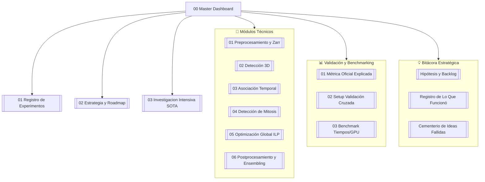

# 🏆 Master Dashboard — Biohub Cell Tracking

> [!IMPORTANT]
> **Meta del Proyecto:** Alcanzar posiciones de medalla de oro / top del Leaderboard en la competencia **Biohub - Cell Tracking During Development** mediante un ciclo riguroso de hipótesis, validación local alineada al 100% con la métrica oficial y optimización sistemática.

---

## 🗺️ Mapa de Navegación de la Librería (MOC)

---

## 📈 Estado Actual del Leaderboard & Progreso

| Métrica | Baseline (Nearest Neighbor) | Meta Fase 1 (DL + LAP) | Meta Fase 2 (SOTA + ILP) | Top 1 Target |
|---|---|---|---|---|
| **CV Total Score** | `~0.143` | `> 0.550` | `> 0.750` | `> 0.850+` |
| **Edge Jaccard** | `~0.143` | `> 0.500` | `> 0.700` | `> 0.800+` |
| **Division Jaccard** | `0.000` (no predice mitosis) | `> 0.200` | `> 0.450` | `> 0.600+` |
| **Inference Time (4 clips)** | `< 2 min` | `< 20 min` | `< 45 min` | `< 2 horas` |

---

## ⚡ Reglas de Oro de Experimentación

1. **Nunca confundir full-fit con CV:** Cada cambio se evalúa en un split validado ([[Validacion_y_Metricas/02_Setup_Validacion_Cruzada_Local|Setup CV]]). Una revisión final `100 % train / 0 % validación`, como EXP-030B o la revisión full-fit de EXP-031, debe registrar CV como `N/A` y heredar su justificación de una receta previamente analizada; la loss de train no es evidencia de generalización.
2. **Desacoplar Detección de Asociación:** Evaluar independientemente la detección 3D (F1-score / Hungarian matching por frame) y la asociación temporal / mitosis (Edge & Division Jaccard).
3. **Registrar TODO:** Si una idea no funcionó, se documenta en [[Bitacora_Estrategica/Cementerio_de_Ideas_Fallidas|Cementerio de Ideas Fallidas]] explicando *por qué* (sobreajuste, lentitud, penalización de métrica).
4. **Respetar el límite de inferencia Kaggle:** Inferencia total en test oculto $\le 12	ext{ h}$ GPU, internet deshabilitado.

---

## 🔗 Accesos Rápidos
- 🧪 **Nuevo Experimento:** [[Experimentos/Template_Nuevo_Experimento|Crear Nota de Experimento]]
- 📋 **Tabla de Experimentos:** [[01_Registro_Experimentos|Ver todos los experimentos]]
- 🚦 **Promotion Board:** [[Validacion_y_Metricas/04_Experiment_Promotion_Board|Selector de candidatos Kaggle]]
- 🖥️ **Cluster GPU Remoto:** [[Infraestructura_Computo_Remoto|Ver máquinas disponibles (A1560, A1552, A1556, A1557)]]
- 📚 **Literatura Descargada:** [[Literatura_y_Referencias/Mapeo_Papers_a_Implementaciones|Mapeo de Papers]]
