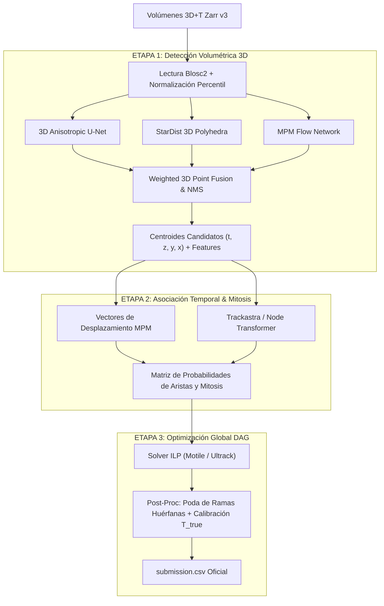

# 🔬 Investigación Intensiva: Estrategia de Ingeniería y Solución SOTA para Biohub Cell Tracking

> [!IMPORTANT]
> **Resumen Ejecutivo:**
> Esta investigación desglosa la formulación matemática del problema, analiza a fondo el código base del starter kit oficial (`tracking_cellmot`), la literatura científica descargada (`Ultrack`, `MPM`, `Trackastra`, `StarDist 3D`, `Motile`) y las características físico-biológicas del dataset de pez cebra en Zarr v3. 
> Define la **hoja de ruta técnica de alta precisión** para construir un pipeline competitivo con capacidad de alcanzar el Top del Leaderboard utilizando el cluster de 4x RTX 4090.

---

## 1. Análisis Profundo del Problema y del Dataset

### 1.1 Fisiología y Óptica de los Datos (Embriones de Pez Cebra en 4D)
- **Modalidad:** Microscopía de fluorescencia 3D time-lapse (Light-Sheet / Confocal) de núcleos y membranas celulares durante la gastrulación y epibolia del pez cebra.
- **Dimensiones por muestra:** $(T, Z, Y, X) = (100, 64, 256, 256)$ en formato Zarr v3 (`uint16`).
- **Anisotropía Óptica Fundamental ($4:1$):**
  $$\text{Scale}_Z = 1.625\,\mu\text{m/vóxel}, \quad \text{Scale}_Y = 0.40625\,\mu\text{m/vóxel}, \quad \text{Scale}_X = 0.40625\,\mu\text{m/vóxel}$$
  *Implicancia Clave:* Un desplazamiento de 1 vóxel en $Z$ equivale a 4 vóxeles en $X/Y$. Cualquier modelo con convoluciones cúbicas $3\times3\times3$ estándar sin reescalado o convoluciones anisotrópicas $(1,3,3)$ subestima fuertemente la distancia física en $Z$.
- **Anotación Dispersa (Sparse Ground Truth):**
  Los archivos `.geff` anotan solo un subconjunto de células ($\sim 15\%\text{--}40\%$ del total). El campo de metadatos `estimated_number_of_nodes` proporciona el estimado real de células totales por clip.

---

## 2. Deconstrucción Matemática de la Métrica Oficial

$$\text{Score} = \text{Adjusted\_Edge\_Jaccard} + 0.1 \times \text{Division\_Jaccard}$$

```mermaid
graph TD
    subgraph Edge_Jaccard ["1. Adjusted Edge Jaccard"]
        A[Detecciones Predichas vs GT] -->|Bipartite Match <= 7.0 µm| B[Nodos Emparejados]
        B -->|Aristas predichas con ambos extremos en GT| C[True Positives (TP)]
        C --> D["Jaccard = TP / (TP + FP + FN)"]
        D -->|Penalización por sobre-predicción| E["Adjusted = Jaccard * max(0, 1 - 0.1 * (T_pred - T_true)/T_true)"]
    end

    subgraph Division_Jaccard ["2. Division Jaccard (Mitosis)"]
        F[Nodos con out-degree >= 2] -->|Ventana de división +/- 1 timepoint| G[Validación Topológica Bipartita]
        G --> H["Division Jaccard = TP_div / (TP_div + FP_div + FN_div)"]
    end

    E --> SCORE["Score Final Combinado"]
    H -->|Peso 0.10| SCORE
```

### 💡 Vectores de Ganancia de Score (Insights Competitivos)
1. **El "Free +0.08" de la Mitosis:**
   - La mayoría de los baselines públicos (incluyendo Nearest Neighbor) ignoran la mitosis (`division_jaccard = 0.0`).
   - Un detector explícito de mitosis que alcance `division_jaccard = 0.60` suma **$+0.060$ puntos netos directos** al Leaderboard.
2. **La Trampa de la Sobre-Predicción de Nodos:**
   - Si un modelo predice un $50\%$ más de nodos que `T_true` ($T_{\text{pred}} = 1.5 \times T_{\text{true}}$), la métrica penaliza el `edge_jaccard` multiplicándolo por $1 - 0.1 \times 0.5 = 0.95$ (pérdida del 5% del score).
   - **Estrategia:** Calibrar el umbral de detección $\tau$ dinámicamente para que $T_{\text{pred}} \approx T_{\text{true}}$.
3. **Tolerancia Temporal de Mitosis:**
   - La métrica tolera que la bifurcación se detecte 1 frame antes o después del ground-truth (`late_division / early_division`), lo que relaja la exactitud del timepoint exacto siempre que la topología de ramas hijas sea consistente.

---

## 3. Arquitectura del Sistema SOTA Propuesto (3 Etapas)



---

## 4. Estrategia Detallada por Componentes

### 4.1 Componente A: Detección 3D y Regresión de Centroides
1. **Manejo de la Anisotropía:**
   - Entrada: Parches de $(16, 64, 64)$ en $(Z, Y, X)$ que corresponden físicamente a $(26.0\,\mu\text{m}, 26.0\,\mu\text{m}, 26.0\,\mu\text{m})$ cúbicos reales.
   - Encoders: Primer bloque con convoluciones $(1, 3, 3)$ seguidas de $(3, 3, 3)$ una vez que las dimensiones espaciales se igualan en resolución perceptiva.
2. **Representación del Target:**
   - Heatmap continuo Gaussiano 3D con $\sigma_z = 1.0, \sigma_y = \sigma_x = 2.0$ vóxeles (isotrópico en micrones $\approx 1.6\,\mu\text{m}$).
   - **Loss:** Masked Focal MSE Loss para no penalizar células presentes no anotadas en el ground truth disperso.
3. **Local Maxima Extraction:**
   - Picos locales con `skimage.feature.peak_local_max(min_distance=(2, 4, 4))` y refinamiento parabólico sub-vóxel.

### 4.2 Componente B: Asociación Temporal (Motion Vectors & Transformers)
1. **Motion & Position Map (MPM - Hayashida et al., CVPR 2020):**
   - La red predice en cada vóxel: $\left[ H_t, \mathbf{v}_{t \to t-1}, \mathbf{v}_{t \to t+1} \right]$.
   - El vector predicho $\mathbf{v}$ proyecta el centroide al frame $t+1$, reduciendo el radio de búsqueda de $15\,\mu\text{m}$ a $< 3\,\mu\text{m}$.
2. **Node Transformer (Trackastra / Gallusser et al., ECCV 2024):**
   - Construye embeddings de nodo usando pooling trilineal de los mapas de características de la U-Net.
   - Capas de atención cruzada bidireccional entre nodos de $t$ y $t+1$ con codificación posicional relativa $\Delta \mathbf{r} = (\mathbf{x}_{t+1} - \mathbf{x}_t) / \text{Scale}$.

### 4.3 Componente C: Detección Explícita de Mitosis
1. **Clasificador de División:**
   - Para cada nodo en $t$, evaluar si existen 2 nodos en $t+1$ candidatos a hijas que cumplan:
     $$\|\mathbf{x}_{\text{padre}} - \frac{\mathbf{x}_{\text{hija}_1} + \mathbf{x}_{\text{hija}_2}}{2}\| \le \epsilon_{\text{centroide}}$$
     $$\cos(\theta_{\text{hija}_1 - \text{padre}}, \theta_{\text{hija}_2 - \text{padre}}) \approx -1 \quad (\text{separación opuesta } 180^\circ)$$
2. **Inyección en el Grafo:**
   - Agregar aristas dirigidas $(\text{padre} \to \text{hija}_1)$ y $(\text{padre} \to \text{hija}_2)$ con score de confianza conjunto.

### 4.4 Componente D: Optimización Global por ILP (Motile / Ultrack)
- Reemplazar el Hungarian matching greedy por resolución global exacta con Programación Lineal Entera:
  $$\min \sum_{u} c_u x_u + \sum_{u,v} c_{uv} y_{uv} + \sum_{u} c_u^{\text{div}} d_u$$
  sujeto a:
  - In-degree $\le 1$
  - Out-degree $\le 2$
  - $d_u = 1 \iff \text{out-degree}(u) = 2$
- **Solvers soportados:** SCIP / HiGHS (integrados en `motile`, de código abierto y ejecutables sin internet en Kaggle).

---

## 5. Matriz de Distribución de Experimentos en Cluster (4x RTX 4090)

| Máquina | Rol Asignado | Experimento Inmediato | Métricas a Monitorear |
|:---:|:---|:---|:---|
| **`A1560-UBU`** | Worker 1: 3D U-Net Heatmap | `EXP-001`: U-Net 3D Anisotrópica + Focal Loss | F1-Score detección, Local Maxima MSE |
| **`A1556-UBU`** | Worker 2: MPM & StarDist 3D | `EXP-002`: U-Net 3D con cabezal de vectores de flujo $\mathbf{v}$ | Error angular de flujo, recall en mitosis |
| **`A1552-UBU`** | Worker 3: Pipeline ILP Motile | `EXP-003`: Integración de solver ILP global sobre detecciones | Edge Jaccard, Division Jaccard |
| **`A1557-UBU`** | Worker 4: 5-Fold CV & Hyperopt | `EXP-004`: Validación cruzada 5-fold embryo-disjoint y tuning de $\tau$ | Score final global ponderado |

---

## 6. Próximos Pasos Inmediatos de Implementación
1. **Configurar el entorno virtual común:** Crear `environment.yml` con `torch`, `scipy`, `blosc2`, `zarr`, `motile`, `scikit-image`.
2. **Implementar `src/metrics.py` local:** Adaptar el script oficial del starter kit para evaluar cualquier `submission.csv` contra los `.geff` locales en segundos.
3. **Lanzar `EXP-001` (3D U-Net) en `A1560-UBU`:** Entrenar el primer detector neuronal profundo volumétrico.
