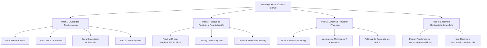

# 🧭 Principio Guía: Validación Rigurosa, Diversidad Metodológica y Alineación con el Leaderboard

## 🎯 1. Advertencia Crítica: El Riesgo de Reducir el Conjunto de Validación
- **Sesgo de Varianza Muestral:** Al reducir el conjunto de validación (por ejemplo, a un 10% / 20 volúmenes), la muestra evaluada tiene menor diversidad biológica. Un score alto en una muestra pequeña puede deberse a menor variabilidad en esos volúmenes específicos y no necesariamente a una mayor capacidad de generalización.
- **Regla Inquebrantable:** La reducción del conjunto de validación **NO es el único camino** ni debe ser la única variable de investigación.

---

## 🔬 2. Los 4 Pilares de Exploración Obligatoria (Diversidad en el Cluster)

Para garantizar un progreso sólido y resistente al overfitting del Leaderboard, el cluster debe investigar de manera simultánea y profunda a través de 4 pilares ortogonales:

---

## 🏆 3. La Verdad Última: El Leaderboard de Kaggle (Test Set Secreto)
- Todas las mejoras observadas en validación local (tanto en esquemas 80/20 como 90/10) deben ser **contrastadas y validadas directamente con los envíos al Leaderboard público de Kaggle**.
- Cada arquitectura con alto potencial se evalúa en el benchmark consistente de 40 volúmenes (80/20) para comparar manzanas con manzanas antes de fusionarse en el ensamble final.
