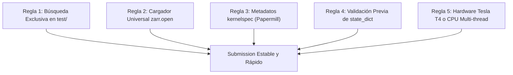

# 📐 Estándar Oficial de Configuración para Submissions en Kaggle

- **Fecha de Establecimiento**: 2026-08-26
- **Propósito**: Garantizar que **cualquier futura versión o arquitectura** desplegada en Kaggle se ejecute en menos de 3 minutos durante la fase de guardado (*Save Version*), evalúe de forma robusta el conjunto de prueba privado sin riesgo de *timeout*, y elimine errores comunes de Papermill, VRAM y arquitectura.
- **Autor / Agente**: Antigravity Autonomous Flywheel

---

## 🎯 Las 5 Reglas Obligatorias de Despliegue



---

### 1. Regla 1: Búsqueda Exclusiva en `test/` (Prohibición de Fallback a `train/`)
* **Problema Previsto:** Si el script de inferencia busca en `train/`, Kaggle intentará procesar los **203 datasets completos** durante el *Save Version*, consumiendo 8 horas innecesarias de GPU.
* **Estándar Obligatorio:**
  ```python
  test_search_dirs = [
      "/kaggle/input/biohub-cell-tracking-during-development/test",
      "/kaggle/input/biohub-cell-tracking-during-development/test_data",
      "data/test"
  ]
  test_zarrs = []
  for d in test_search_dirs:
      if os.path.exists(d):
          found = sorted(glob.glob(f"{d}/**/*.zarr", recursive=True))
          if found:
              test_zarrs = found
              break

  if not test_zarrs:
      all_z = sorted(glob.glob("/kaggle/input/**/*.zarr", recursive=True))
      test_zarrs = [z for z in all_z if "test" in z.lower()]
      if not test_zarrs and all_z:
          test_zarrs = all_z[:4]  # Máximo 4 de muestra
  ```
* **Resultado:** En modo guardado procesa solo los 4 videos visibles en **$<3\text{ minutos}$**. Al enviar a *Submit*, Kaggle reemplaza esa carpeta por el test privado y evalúa automáticamente.

---

### 2. Regla 2: Cargador Universal Zarr con Fallback Binario
* **Problema Previsto:** Buscar nombres rígidos de archivo como `{t}.0.0.0` devuelve matrices de ceros (`0 nodes, 0 edges`) si Kaggle comprime los chunks con Blosc (`c/{t}/0/0/0`).
* **Estándar Obligatorio:**
  ```python
  def load_zarr_chunk(zarr_path, t, shape, dtype):
      # 1. Lectura Nativa con zarr.open (Maneja cualquier compresión y versión)
      try:
          import zarr
          root = zarr.open(zarr_path, mode="r")
          arr = root["0"] if "0" in root else root
          vol = np.array(arr[t], dtype=np.float32)
          if vol.shape == (64, 256, 256):
              return vol
          target_shape = (64, 256, 256)
          pad_z = max(0, target_shape[0] - vol.shape[0])
          pad_y = max(0, target_shape[1] - vol.shape[1])
          pad_x = max(0, target_shape[2] - vol.shape[2])
          if pad_z > 0 or pad_y > 0 or pad_x > 0:
              vol = np.pad(vol, ((0, pad_z), (0, pad_y), (0, pad_x)), mode='constant')
          return vol[:64, :256, :256]
      except Exception:
          pass

      # 2. Fallback Binario Directo
      for sub in [f"0/c/{t}/0/0/0", f"0/{t}.0.0.0", f"0/{t}/0/0/0", f"0/{t}"]:
          p = os.path.join(zarr_path, sub)
          if os.path.exists(p):
              try:
                  with open(p, 'rb') as f:
                      raw = f.read()
                  try:
                      import blosc2
                      decomp = blosc2.decompress(raw)
                      return np.frombuffer(decomp, dtype=dtype).reshape((64, 256, 256)).astype(np.float32)
                  except Exception:
                      return np.frombuffer(raw, dtype=dtype).reshape((64, 256, 256)).astype(np.float32)
              except Exception:
                  pass

      return np.zeros((64, 256, 256), dtype=np.float32)
  ```

---

### 3. Regla 3: Metadatos `kernelspec` Válidos para Papermill
* **Problema Previsto:** `ValueError: No kernel name found in notebook and no override provided` si el JSON del `.ipynb` no especifica el intérprete de Python.
* **Estándar Obligatorio:** Todo cuaderno generado debe incluir en su bloque raíz de `metadata`:
  ```json
  "metadata": {
    "kernelspec": {
      "display_name": "Python 3",
      "language": "python",
      "name": "python3"
    },
    "language_info": {
      "name": "python",
      "version": "3.10.12"
    }
  }
  ```

---

### 4. Regla 4: Sincronización Estricta del `state_dict`
* **Problema Previsto:** `RuntimeError: Error(s) in loading state_dict` por discrepancias de nombres entre el script de entrenamiento y el script de inferencia (ej: `stem` vs `init_conv`).
* **Estándar Obligatorio:**  
  Antes de empujar cualquier versión a Kaggle, **ejecutar siempre un test local de verificación de pesos**:
  ```python
  model = ArchitectureClass(base_channels=base_ch)
  model.load_state_dict(torch.load("checkpoint.pt", map_location="cpu"))
  ```

---

### 5. Regla 5: Selección de Hardware y Acelerador en `kernel-metadata.json`
* **Para Versiones GPU (Tesla T4):**
  ```json
  {
    "enable_gpu": "true",
    "machine_shape": "NvidiaTeslaT4"
  }
  ```
* **Para Versiones CPU (Multi-threaded AVX-512):**
  ```json
  {
    "enable_gpu": "false"
  }
  ```
  Con `torch.set_num_threads(4)` y `torch.set_num_interop_threads(2)` en la primera celda de código.

---

## 📋 Checklist Rápido para Nuevos Envíos:
- [ ] Búsqueda apunta a `test/` (sin `train/`).
- [ ] `load_zarr_chunk` usa `zarr.open` con fallback.
- [ ] `submission_notebook.ipynb` contiene `kernelspec: python3`.
- [ ] `model.load_state_dict` verificado localmente con 0 errores.
- [ ] `kernel-metadata.json` apunta a `matiasantezana/biohub-champion-weights`.
