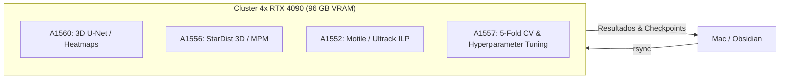

# 🖥️ Infraestructura de Cómputo Remoto (Cluster 4x RTX 4090)

> [!IMPORTANT]
> **Máquinas Autorizadas para la Competencia:**
> Las únicas computadoras habilitadas para procesar datos, entrenar modelos y correr optimizaciones ILP son:
> - **`A1560-UBU`** (`100.84.253.117:2222`) — RTX 4090 (24 GB) - Conda: `train-60`
> - **`A1552-UBU`** (`100.112.138.117:2222`) — RTX 4090 (24 GB) - Conda: `train-52`
> - **`A1556-UBU`** (`100.107.113.22:2222`) — RTX 4090 (24 GB) - Conda: `train-56`
> - **`A1557-UBU`** (`100.87.128.33:2222`) — RTX 4090 (24 GB) - Conda: `base`
> - **`A1558-UBU`** (`100.110.124.116:2222`) — RTX 4090 (24 GB) - Conda: **`test58`** (Habilitada y Autorizada)

---

## 📊 Matriz de Asignación de Roles por Máquina



---

## 🔑 Especificaciones de Conexión

| Parámetro | Valor |
|---|---|
| **Red VPN** | Tailscale Mesh (`cuentaauxiliar2a2parte@gmail.com`) |
| **Usuario SSH** | `alumno1` (sin privilegios sudo) |
| **Puerto SSH** | `2222` (sshd local en espacio de usuario) |
| **Autenticación** | Llave SSH Mac (`~/.ssh/id_ed25519`) |
| **Herramienta de Transferencia** | `rsync` (no usar `scp`) |

---

## 🚀 Comandos Rápidos de Sincronización

```bash
# Subir código a A1560
rsync -av --exclude '.git' --exclude '__pycache__' -e "ssh -p 2222" ./ alumno1@100.84.253.117:Documents/Biohub/

# Subir código a A1552
rsync -av --exclude '.git' --exclude '__pycache__' -e "ssh -p 2222" ./ alumno1@100.112.138.117:Documents/Biohub/

# Subir código a A1556
rsync -av --exclude '.git' --exclude '__pycache__' -e "ssh -p 2222" ./ alumno1@100.107.113.22:Documents/Biohub/

# Subir código a A1557
rsync -av --exclude '.git' --exclude '__pycache__' -e "ssh -p 2222" ./ alumno1@100.87.128.33:Documents/Biohub/
```

Para documentación de bajo nivel, consultar `../SSH-Context.md` y `../Computo_Remoto_Disponibles.md`.

---

## ☁️ Integración CamberCloud MCP (Plan GitHub Honor Roll)

**Cuenta activa:** `matiantezana` (`matycaba2016@gmail.com`)
**Límites de cuota del plan:**
- 🟢 **5 Horas de GPU** (Single GPU NVIDIA L4)
- 🟢 **40 Horas de CPU**
- 🟢 **50 GB Almacenamiento**
- 🟢 **50 Mensajes LLM**

*Regla:* Todo experimento enviado mediante `camber-mcp` debe estar configurado para no exceder las 5 horas de GPU.

