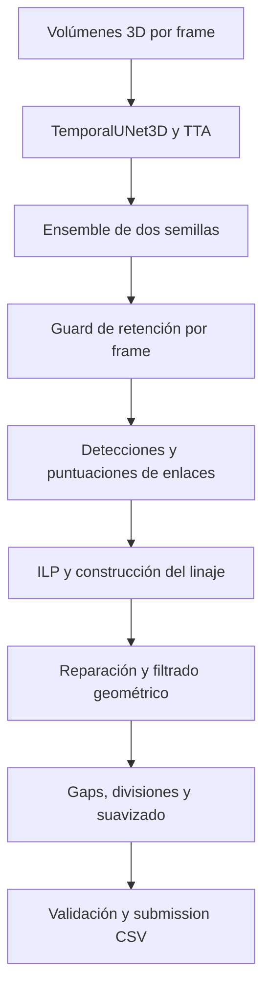

# Análisis del pipeline BioHub Cell Tracking

## Resumen general

El notebook implementa un pipeline de **seguimiento celular 4D**: trabaja con volúmenes tridimensionales a lo largo del tiempo, detecta células en cada frame y reconstruye sus trayectorias y eventos de división.

La idea central consiste en combinar:

- predicción mediante modelos de Deep Learning;
- ensemble de dos modelos entrenados con semillas diferentes;
- Test-Time Augmentation (TTA);
- optimización global mediante Integer Linear Programming (ILP);
- restricciones temporales, geométricas y biológicas;
- reparación conservadora de trayectorias incompletas;
- validaciones estructurales y de reproducibilidad.

En términos simples, **los modelos proponen detecciones y asociaciones, el optimizador construye un grafo consistente y el postprocesamiento corrige únicamente casos de alta confianza**.

## Explicación breve para una presentación

> Desarrollé un pipeline de seguimiento celular 4D para datos volumétricos. Parto de un modelo temporal basado en UNet3D y Transformer que detecta centros celulares y estima asociaciones entre frames. Luego combino dos modelos entrenados con semillas distintas, aplico Test-Time Augmentation y optimización global mediante ILP para construir linajes consistentes. Finalmente, incorporo postprocesamiento geométrico y temporal: reparación conservadora de gaps, relinking basado en movimiento, detección de divisiones con reglas estructurales y suavizado de trayectorias. Todo el flujo valida que el resultado respete restricciones de linaje, como un solo padre por célula, hasta dos hijas por división y enlaces únicamente entre frames consecutivos.

## 1. Problema que resuelve

Cada célula se representa como un nodo:

$$
n = (t,z,y,x)
$$

donde:

- $t$ es el frame temporal;
- $(z,y,x)$ representa la posición tridimensional de la célula.

Una arista dirigida conecta una célula del frame $t$ con su continuación en $t+1$. El pipeline debe resolver cuatro problemas relacionados:

1. **Detección:** encontrar los centros celulares en cada volumen 3D.
2. **Asociación temporal:** determinar qué detección del siguiente frame corresponde a cada célula.
3. **Detección de divisiones:** identificar cuándo una célula origina dos células hijas.
4. **Recuperación de errores:** reconstruir trayectorias cuando el detector pierde temporalmente una célula.

El resultado es un grafo de linajes exportado como CSV. Las filas de tipo `node` representan células y las filas de tipo `edge` representan relaciones temporales.

## 2. Arquitectura principal

| Módulo | Función |
|---|---|
| TemporalUNet3D | Extrae características espaciales y temporales del volumen y genera logits de detección. |
| Node Transformer / edge predictor | Puntúa qué pares de células de frames consecutivos deberían conectarse. |
| Ensemble de dos checkpoints | Reduce la dependencia de una única inicialización o semilla de entrenamiento. |
| ILP | Selecciona globalmente las asociaciones compatibles con las restricciones del linaje. |
| DeepCenterUNet3D | Verifica localmente determinadas reparaciones propuestas. |
| Postprocesamiento geométrico | Repara enlaces, gaps y divisiones, filtra ruido y suaviza las trayectorias. |

## 3. Flujo completo

## 4. Ensemble de dos modelos independientes

El pipeline utiliza un modelo principal y un modelo secundario entrenado con una semilla diferente. La razón es que dos entrenamientos independientes no suelen cometer exactamente los mismos errores.

Antes de mezclar las predicciones, los logits del modelo secundario se alinean con la escala del modelo principal mediante sus medias y desviaciones estándar. Esto evita combinar valores que tengan distribuciones numéricas incompatibles.

La detección combinada puede expresarse como:

$$
d_{mix}=(1-\alpha)d_{primary}+\alpha\widetilde{d}_{secondary}
$$

En la configuración seleccionada:

- el peso secundario de detección es `0.475`;
- el peso secundario para asociaciones temporales es `0.15`;
- el modo de combinación de enlaces es `low_margin_consensus`.

El modelo secundario influye principalmente cuando el modelo principal está inseguro y ambos modelos coinciden en el candidato más probable. Si el modelo principal ya muestra un margen de confianza alto, la influencia secundaria es menor.

### Cómo explicarlo

> En lugar de confiar en un único checkpoint, utilizo un ensemble de dos modelos entrenados con seeds diferentes. El segundo modelo no reemplaza al principal: aporta evidencia adicional, especialmente en asociaciones ambiguas.

## 5. Test-Time Augmentation

El notebook aplica ocho transformaciones espaciales sobre el plano de la imagen, incluyendo:

- identidad;
- reflexiones horizontales y verticales;
- reflexión sobre ambos ejes;
- rotaciones de 90° y 270°;
- transposición;
- una transformación equivalente a una antitransposición.

El modelo realiza una predicción para cada vista. Después se invierten las transformaciones y se promedian las salidas.

Esta estrategia reduce la sensibilidad del detector a la orientación del volumen y mejora la estabilidad de las predicciones.

### Cómo explicarlo

> Apliqué TTA para que el detector fuera menos sensible a la orientación espacial. Predigo sobre distintas rotaciones y reflexiones del mismo volumen y combino las salidas en el sistema de coordenadas original.

## 6. Guard de retención por frame

Un ensemble no necesariamente mejora todos los ejemplos. En algunos frames, la combinación puede eliminar detecciones válidas del modelo principal. Para evitarlo, el código calcula:

$$
retention = \frac{candidatos\ del\ ensemble}{candidatos\ del\ modelo\ principal}
$$

Si el valor cae por debajo de `0.90`, se descarta la predicción combinada únicamente para ese frame y se conserva la salida del modelo principal.

La protección se aplica de forma local, no a toda la película. Según los registros incluidos en el notebook, se activó en 60 de los 400 frames analizados, concentrados en una secuencia particularmente difícil.

### Importancia de la estrategia

Esta protección transforma el ensemble en un mecanismo más conservador: permite aprovechar sus mejoras sin aceptar automáticamente sus degradaciones más evidentes.

### Cómo explicarlo

> Agregué un guard por frame para controlar la degradación del ensemble. Si la mezcla reduce en más de un 10 % la cantidad de candidatos respecto del modelo principal, conservo la predicción principal para ese frame.

## 7. Predicción de asociaciones temporales

Después de detectar células, el modelo debe decidir qué nodos de frames consecutivos están relacionados. El componente Transformer o `edge predictor` utiliza las características aprendidas por la UNet y las posiciones de los candidatos para calcular logits de asociación.

El código también combina las predicciones de enlaces de los dos modelos. En el modo `low_margin_consensus`:

- se calculan las probabilidades de asociación;
- se comparan los dos mejores candidatos del modelo principal;
- se mide el margen entre ellos;
- el modelo secundario influye más cuando el margen primario es bajo;
- la mezcla se anula si ambos modelos no coinciden en el mejor padre.

Esto concentra el ensemble en los casos donde realmente puede aportar información.

## 8. Optimización global mediante ILP

Las aristas no se aceptan de manera independiente. El pipeline utiliza **Integer Linear Programming** para seleccionar una combinación global de enlaces.

El ILP permite considerar simultáneamente:

- puntuación de cada asociación;
- costos de aparición y desaparición;
- eventos de división;
- restricciones sobre padres e hijos;
- compatibilidad global entre las aristas seleccionadas.

Las restricciones fundamentales son:

- cada célula puede tener como máximo un padre;
- cada célula puede tener hasta dos hijas;
- los enlaces deben avanzar temporalmente;
- una misma detección no puede pertenecer a asociaciones incompatibles.

En la configuración analizada, la penalización de desaparición es `1.5`. Esto favorece preservar trayectorias y evita cortes innecesarios cuando existe una asociación razonable.

### Cómo explicarlo

> El modelo genera probabilidades de enlace, pero la decisión final se toma globalmente mediante ILP. Esto evita que asociaciones localmente buenas produzcan un grafo incompatible con la estructura de un linaje celular.

## 9. Paralelización en múltiples GPU

Cuando hay dos o más GPU disponibles, el notebook divide las películas entre procesos independientes. Cada proceso recibe:

- una GPU determinada mediante `CUDA_VISIBLE_DEVICES`;
- un subconjunto de los videos;
- un nombre de método diferente para evitar colisiones de archivos.

Al finalizar, se validan y fusionan los grafos generados por los distintos procesos.

Se trata de paralelismo de inferencia por datos, no de entrenamiento distribuido: cada GPU procesa películas diferentes usando los mismos modelos.

## 10. Filtrado inicial del grafo

Antes de agregar reparaciones, el pipeline elimina asociaciones estructuralmente problemáticas. Entre otras cosas:

- descarta enlaces que no conectan frames consecutivos;
- elimina aristas excesivamente largas;
- impide que una célula tenga múltiples padres;
- controla la cantidad de hijos;
- elimina aristas colgantes;
- puede descartar nodos completamente aislados.

El umbral máximo general de distancia para una arista es `14.0 µm`, aunque distintas operaciones usan límites más estrictos.

## 11. Reparación de trayectorias mediante movimiento

El módulo de *motion relinking* intenta recuperar asociaciones cuando una trayectoria queda cortada.

La decisión combina:

- distancia física en micrómetros;
- dirección estimada del movimiento;
- velocidad local;
- coherencia con nodos anteriores o posteriores;
- respaldo del modelo aprendido;
- umbrales de búsqueda estrictos y relajados.

Los umbrales principales son:

- distancia estricta: `6.0 µm`;
- distancia relajada: `10.0 µm`;
- peso de velocidad: `0.5`;
- bonificación para asociaciones aprendidas: `1.0`.

### Cómo explicarlo

> Cuando una trayectoria se corta, no reconecto células solamente por cercanía. También evalúo si el desplazamiento es compatible con la dirección y la dinámica reciente del track.

## 12. Cierre conservador de gaps

Un gap ocurre cuando una célula desaparece durante un frame y vuelve a ser detectada posteriormente. Para cerrar gaps, el pipeline:

1. identifica finales de trayectorias;
2. identifica comienzos de trayectorias posteriores;
3. calcula distancias físicas entre candidatos;
4. construye una matriz de costos;
5. utiliza el algoritmo húngaro mediante `linear_sum_assignment`;
6. selecciona correspondencias uno a uno;
7. agrega nodos sintéticos en los frames faltantes;
8. crea nuevas aristas para completar la trayectoria.

El matching global evita que varios finales intenten conectarse con el mismo inicio.

### Umbral adaptativo según densidad

El radio de aceptación se adapta a la separación local entre células:

- en regiones densas, los enlaces deben ser más estrictos;
- en regiones dispersas, se permite una tolerancia ligeramente mayor.

El valor de referencia de densidad es `6.5 µm`, con una ganancia de adaptación de `0.04` y un cambio máximo por paso de `0.125 µm`.

### Refinamiento del nodo sintético

La posición inicial del nodo faltante se calcula mediante interpolación. Luego se examina una pequeña ventana de la imagen para desplazar el punto hacia una ubicación con mayor evidencia visual, limitando el movimiento máximo del refinamiento.

## 13. DeepCenterUNet3D como verificador auxiliar

DeepCenterUNet3D se usa como un mecanismo de confirmación localizado. No reemplaza las detecciones principales ni modifica todo el grafo.

Su función es verificar si existe evidencia visual suficiente alrededor de una reparación propuesta. En la configuración seleccionada:

- se utiliza para confirmar determinados gaps;
- el umbral de activación es `0.25`;
- el checkpoint esperado corresponde a la época `500`;
- la confirmación se exige principalmente para gaps con una separación suficientemente grande.

Esta estrategia puede describirse como **add-only gate**: el modelo auxiliar controla elementos nuevos, sin modificar las predicciones base que ya fueron aceptadas.

### Cómo explicarlo

> Utilizo un segundo modelo de centros como validador localizado. No modifica las detecciones existentes: únicamente determina si una reparación propuesta tiene suficiente soporte en la imagen.

## 14. Detección conservadora de divisiones

Las divisiones son difíciles porque agregar una segunda hija incorrecta crea una bifurcación falsa. Por eso el código aplica una regla deliberadamente restrictiva.

Para agregar una segunda hija se exige que:

1. el padre ya tenga exactamente una hija enlazada;
2. el posible segundo hijo sea un nodo huérfano;
3. el padre tenga un predecesor, evitando dividir inicios de tracks;
4. la segunda hija esté cerca del padre;
5. las dos hijas estén suficientemente cerca entre sí;
6. la candidata sea la huérfana mutuamente más cercana;
7. ambas hijas continúen hasta el frame `t+2`;
8. las trayectorias de las hijas diverjan después de la división;
9. no se superen los límites por frame y globales.

Los umbrales seleccionados son:

- distancia máxima entre padre y segunda hija: `8.0 µm`;
- distancia máxima entre hermanas: `11.0 µm`;
- distancia máxima entre padre y la hija ya existente: `10.0 µm`;
- divergencia mínima posterior: `2.25 µm`.

### Importancia de la divergencia

La divergencia en `t+2` es una condición temporal fuerte. Dos células cercanas pueden parecer hijas por casualidad, pero después de una mitosis deberían generar trayectorias que comienzan a separarse.

### Cómo explicarlo

> No detecto una división sólo porque haya dos células cercanas. Exijo evidencia estructural y temporal: proximidad coherente, una candidata huérfana, continuidad de ambas hijas y separación posterior compatible con una mitosis.

## 15. Filtrado de trayectorias cortas

Los componentes con menos de seis nodos se consideran potencialmente espurios y se eliminan. Sin embargo, el código conserva componentes cortos que contienen divisiones, porque podrían representar eventos biológicamente importantes.

Existe un mecanismo opcional para rescatar componentes cortos de alta confianza cuando el filtrado elimina una fracción excesiva del grafo. En la configuración seleccionada, ese rescate adaptativo se encuentra desactivado, manteniendo una política más conservadora.

## 16. Suavizado de trayectorias

El pipeline aplica un ajuste lineal local a las coordenadas de nodos interiores. Para cada nodo se consideran hasta dos vecinos anteriores y dos posteriores.

Se ajusta una recta para cada coordenada:

$$
z(t),\quad y(t),\quad x(t)
$$

La nueva posición combina la observación original con la posición estimada por el ajuste:

$$
p_{new}=(1-w)p_{original}+wp_{fitted}
$$

con `w = 0.8`.

Este paso reduce el jitter espacial, pero no agrega ni elimina enlaces. Por lo tanto, mejora la geometría sin cambiar la topología ni las identidades celulares.

### Cómo explicarlo

> Al final suavizo la posición de los nodos interiores para reducir ruido de localización. El proceso no modifica las conexiones del linaje.

## 17. Reproducibilidad e ingeniería

El notebook incorpora varias decisiones orientadas a reproducibilidad:

- configuración centralizada mediante variables de entorno;
- manifests para identificar los artefactos correctos;
- validación SHA-256 de los modelos principal y secundario;
- desactivación del fallback silencioso a otros artefactos;
- validación sintáctica de las modificaciones dinámicas;
- comprobación de que cada parche encuentra exactamente el bloque esperado;
- ejecución obligatoria sobre GPU;
- generación de estadísticas de cada corrida;
- identificación de experimentos mediante tags.

Esto evita ejecutar accidentalmente otro checkpoint o una versión incompatible del pipeline.

## 18. Validaciones finales

Antes de aceptar la submission, el notebook comprueba:

- encabezado exacto del CSV;
- IDs de fila contiguos;
- cobertura de todos los datasets de prueba;
- presencia de nodos y aristas;
- tiempos celulares válidos;
- coordenadas espaciales no negativas;
- ausencia de aristas colgantes;
- enlaces únicamente entre frames consecutivos;
- grado de entrada máximo igual a uno;
- grado de salida máximo igual a dos;
- consistencia entre el número de filas, nodos y aristas;
- registros completos del guard de retención;
- hash SHA-256 de la submission final.

Estas validaciones no miden solamente el score: comprueban que el resultado represente un linaje estructuralmente válido.

## 19. Resultados reportados por el notebook

El notebook reporta:

- cuatro secuencias de prueba;
- 400 frames auditados;
- activación del guard en 60 frames;
- alrededor de 237.000 filas en la submission;
- aproximadamente 120.000 nodos y 116.000 aristas;
- score público de `0.913`, frente a un baseline reportado de `0.912`.

Estos valores deben presentarse como resultados del leaderboard público. No demuestran por sí solos la generalización sobre el conjunto privado, especialmente porque la parte pública representa solamente una fracción de los datos evaluados.

## 20. Principales aportes técnicos

Los conceptos más importantes para destacar son:

1. **Ensemble calibrado de modelos temporales independientes.**
2. **TTA espacial de ocho vistas.**
3. **Guard de retención para impedir degradaciones locales del ensemble.**
4. **Optimización global del linaje mediante ILP.**
5. **Asociaciones que combinan aprendizaje, geometría y movimiento.**
6. **Matching húngaro para cerrar gaps de forma uno a uno.**
7. **Umbrales adaptativos según densidad celular.**
8. **DeepCenter como verificador localizado de reparaciones.**
9. **Detección de divisiones con restricciones estructurales y divergencia temporal.**
10. **Filtrado y suavizado sin romper la topología del grafo.**
11. **Paralelización de inferencia en múltiples GPU.**
12. **Auditoría estructural, hashes y configuración reproducible.**

## 21. Cómo presentar honestamente tu contribución

El notebook utiliza modelos y una base de inferencia preexistentes. El aporte visible se concentra principalmente en:

- integración y calibración de dos checkpoints;
- ampliación del TTA;
- guard de retención por frame;
- modificación del flujo de inferencia;
- reglas de recuperación y postprocesamiento;
- control conservador de divisiones;
- validaciones, auditoría y reproducibilidad;
- paralelización y preparación de la submission.

Una formulación fuerte y precisa sería:

> Construí y ajusté una capa de inferencia robusta sobre modelos temporales preentrenados. Implementé un ensemble calibrado, controles de degradación por frame, optimización global de linajes, recuperación geométrica conservadora y validación integral de la salida.

## 22. Cierre para exposición oral

> El principal desafío no era solamente detectar células, sino construir linajes temporalmente consistentes sin introducir asociaciones o divisiones falsas. Por eso combiné modelos aprendidos con optimización global y reglas conservadoras. El ensemble mejora la robustez, el guard impide degradaciones locales, el ILP garantiza consistencia y el postprocesamiento recupera errores únicamente cuando existe evidencia temporal, geométrica y visual suficiente.
