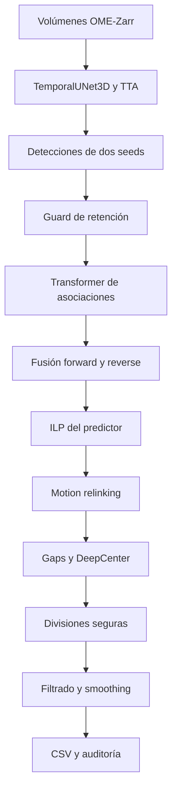

# Análisis exhaustivo de `biohub-track-your-cells-development.ipynb`

**Fecha del análisis:** 27 de agosto de 2026  
**Tipo de revisión:** análisis estático, sin ejecutar las celdas  
**SHA-256 del notebook:** `808aaef3aab4afc7b2d79ee5cb814c24c963c6b48e87f77816e389af5f4d7a22`

## 1. Conclusión ejecutiva

El notebook implementa un pipeline avanzado de **seguimiento celular 3D a lo largo del tiempo**, con detección de centros celulares, asociación temporal, reconstrucción de linajes, recuperación de células perdidas y detección de divisiones.

La solución combina:

- una `TemporalUNet3D` para obtener mapas de detección y características volumétricas;
- un Transformer de nodos para puntuar asociaciones entre células de frames consecutivos;
- dos checkpoints entrenados con semillas diferentes;
- Test-Time Augmentation de ocho vistas;
- fusión de detecciones y asociaciones entre modelos;
- asociación bidireccional forward/reverse mediante una media armónica ponderada;
- optimización ILP dentro del predictor original;
- reconstrucción posterior mediante movimiento y asignación húngara;
- cierre de gaps con interpolación y refinamiento sobre la imagen;
- un `DeepCenterUNet3D` auxiliar como verificador de reparaciones;
- recuperación conservadora de divisiones;
- filtrado de tracks cortos y suavizado de coordenadas;
- auditoría del grafo final y un validador local contra ground truth.

### Veredicto de seguridad

**No encontré malware, prompt injection ni intención maliciosa en las celdas visibles.** No hay reverse shells, exfiltración de credenciales, llamadas HTTP directas, acceso a claves SSH, persistencia, tareas programadas ni comandos destructivos amplios.

Sin embargo, **no es posible certificar como seguro todo el flujo solamente con este `.ipynb`**, porque instala y ejecuta contenido externo:

- wheels y posibles paquetes fuente almacenados en datasets de Kaggle;
- un repositorio de inferencia materializado desde un dataset;
- checkpoints `.pth` y `.pt`;
- un checkpoint cargado con `torch.load(..., weights_only=False)`.

El código aplica hashes SHA-256 sobre el repositorio Python y los checkpoints principales. Esto es una buena defensa de integridad, pero los hashes prueban identidad, no que el contenido original sea benigno. Las wheels tampoco se validan individualmente mediante hashes.

**Recomendación práctica:** ejecutarlo sólo en un entorno efímero y aislado de Kaggle, con Internet desactivado y sin tokens, secretos, Google Drive ni datasets privados innecesarios montados.

### Veredicto técnico

El pipeline contiene ideas valiosas, especialmente el ensemble, el guard de retención, la asignación húngara, el refinamiento de gaps y las auditorías de integridad. No obstante, hay diferencias importantes entre la descripción y el comportamiento real:

1. El validador se presenta como oficial, pero su lógica de divisiones no coincide con la especificación oficial actual.
2. La introducción describe una media armónica entre Edge Jaccard y Division Jaccard; la métrica oficial y el código usan una suma ponderada.
3. El postprocesamiento de movimiento normalmente **reemplaza todas las aristas producidas por el ILP**, por lo que el ILP no define la topología final.
4. La “divergencia angular” de las hijas no calcula ángulos: sólo exige que aumente la distancia entre ellas.
5. La regla denominada “mutual nearest neighbors” verifica la vecindad en una sola dirección.
6. Las estadísticas de divisiones tienen un bug y producen valores imposibles, como `deepcenter_rejected=-87`.
7. Algunos parámetros documentados no coinciden con los realmente utilizados.

## 2. Alcance y metodología

Se inspeccionaron:

- las 22 celdas del notebook;
- las 13 celdas de código y las 9 celdas Markdown;
- los metadatos del kernel y Kaggle;
- imports, funciones, clases y llamadas relevantes;
- usos de `subprocess`, instalación, escritura, borrado y extracción;
- deserialización de modelos;
- patrones de prompt injection;
- cargas HTML o JavaScript en outputs;
- la lógica matemática del ensemble y del validador;
- los resultados almacenados en los outputs.

La revisión fue estática: **no se ejecutó ninguna celda ni se cargó ningún checkpoint**.

## 3. Inventario del archivo

| Propiedad | Valor |
|---|---:|
| Formato | Jupyter Notebook, `nbformat 4.5` |
| Tamaño | 3.629.590 bytes |
| Celdas totales | 22 |
| Celdas de código | 13 |
| Celdas Markdown | 9 |
| Kernel | Python 3.12.13 |
| Entorno | Kaggle |
| Internet declarado | Desactivado |
| Acelerador declarado | Tesla T4 |
| Salidas embebidas | Texto, tablas HTML e imágenes JPEG |

Los outputs embebidos no contienen patrones de `<script>`, `javascript:`, iframes ni manejadores HTML sospechosos.

## 4. Problema modelado

Cada célula es un nodo:

$$
v_i=(t_i,z_i,y_i,x_i)
$$

El voxel es anisotrópico:

$$
(s_z,s_y,s_x)=(1.625,0.40625,0.40625)\ \mu m
$$

La distancia física es:

$$
d(i,j)=\sqrt{(1.625\Delta z)^2+(0.40625\Delta y)^2+(0.40625\Delta x)^2}
$$

Una arista representa continuidad temporal:

$$
v_i(t)\rightarrow v_j(t+1)
$$

Una división se representa como un padre con dos salidas:

$$
\deg^-(v)\leq1,\qquad \deg^+(v)\leq2
$$

## 5. Arquitectura general



## 6. Recorrido por las celdas

| Celdas | Función |
|---|---|
| 0–1 | Introducción, problema, métrica declarada e imagen de portada. |
| 2–3 | Configuración mediante variables de entorno. |
| 4–5 | Guard de invariantes de configuración. |
| 6–7 | Imports, rutas y parámetros. |
| 8–9 | Dependencias offline, repositorio, pesos e integridad SHA-256. |
| 10 | Diagrama externo de arquitectura. |
| 11–12 | TTA, dual-seed, retención, bidireccional e inferencia multi-GPU. |
| 13 | Imagen de linajes. |
| 14–15 | Postprocesamiento y exportación. |
| 16–17 | Auditoría estructural y recibo de integridad. |
| 18–20 | Validación local sobre train. |
| 21 | Manifest del estado realmente resuelto. |

## 7. Configuración y reproducibilidad

Los principales valores efectivos son:

| Parámetro | Valor | Función |
|---|---:|---|
| Umbral de detección | `0.96875` | Aceptar centros de alta confianza. |
| Peso secundario de detección | `0.475` | Mezcla de heatmaps. |
| Peso secundario de asociaciones | `0.15` | Evidencia en casos ambiguos. |
| Umbral de aristas | `0.48` | Generación de candidatos. |
| Retención mínima | `0.90` | Fallback al detector principal. |
| Peso bidireccional | `0.30` | Influencia reverse. |
| Aparición ILP | `0.0` | Costo de aparición. |
| Desaparición ILP | `1.5` | Penalización de cortes. |
| División ILP | `1.0` | Peso de división. |
| Longitud mínima | `6` | Filtrado de tracks. |

La celda de guard verifica algunos valores exactos con tolerancia `1e-12`. Si existe deriva, detiene la ejecución.

Aspectos positivos:

- parámetros centrales explícitos;
- sin fallback silencioso a otro artefacto;
- GPU obligatoria;
- conjunto exacto de archivos Python del soporte;
- SHA-256 por archivo Python;
- hashes fijados para los tres modelos.

Limitación: el guard no cubre todos los valores importantes. Motion gates, smoothing y caps de división dependen de defaults posteriores.

## 8. Dependencias y artefactos

El soporte puede contener:

- `repo/` o `repo.zip`;
- `weights/` o `weights.zip`;
- wheels y paquetes offline;
- `ARTIFACT_MANIFEST.json`.

Si faltan dependencias, ejecuta conceptualmente:

```text
python -m pip install --no-index --no-deps --find-links <directorio> <paquetes>
```

`--no-index` evita PyPI y `--no-deps` reduce cambios no deseados en NumPy/SciPy. La instalación online sólo se activa con `BIOHUB_ALLOW_PIP_INSTALL=1`; permaneció desactivada en la ejecución almacenada.

Después materializa el repositorio en `/kaggle/working/tracking_repo` y verifica hashes de todos sus archivos Python. Es una mejora significativa frente a aceptar cualquier repositorio adjunto.

## 9. Modelo principal

Según la interfaz visible:

1. `model.encode(imgs)` obtiene características y logits de detección.
2. Se extraen centros mediante máximos locales.
3. Se indexan características en las coordenadas detectadas.
4. `model.predict_edges(...)` puntúa pares entre frames.
5. El predictor crea un grafo y puede aplicar ILP.

La implementación completa de `TemporalUNet3D`, el Transformer y el ILP se materializa desde un dataset externo. Los hashes prueban que se utilizó una versión exacta, pero ese código no está dentro del notebook.

## 10. Test-Time Augmentation

El script original usaba cuatro vistas. El notebook lo parchea para aplicar ocho transformaciones del plano XY:

- identidad;
- flip horizontal;
- flip vertical;
- flip doble;
- rotación de 90°;
- rotación de 270°;
- transposición;
- antitransposición.

Cada transformación se revierte antes de acumular logits. La TTA se aplica a ambos modelos.

## 11. Ensemble de dos semillas

### 11.1 Detección

Los logits secundarios se alinean con el principal:

$$
\widetilde{s}=(s-\mu_s)
\operatorname{clip}\left(\frac{\sigma_p}{\sigma_s},0.5,2.0\right)+\mu_p
$$

Luego:

$$
d_{mix}=0.525d_p+0.475\widetilde{d_s}
$$

### 11.2 Guard de retención

Para cada frame:

$$
r=\frac{N_{mix}}{N_{primary}}
$$

Si $r<0.90$, se usa la detección principal. En los outputs se activó en 60 de 400 frames, todos de `44b6_0b24845f`.

La estrategia controla colapsos en cantidad, no necesariamente degradación espacial: una mezcla podría mantener el número de centros pero desplazarlos sin activar el guard.

### 11.3 Asociaciones del segundo seed

En modo `low_margin_consensus`, el segundo modelo influye sólo si el primario tiene un margen bajo y ambos coinciden en el mejor padre:

$$
w_{local}=0.15\cdot
\operatorname{clip}\left(
\frac{0.35-margin_p}{0.35},0,1
\right)
$$

Si no coinciden, el peso secundario se vuelve cero.

## 12. Fusión bidireccional

Se calculan logits forward y reverse. Los reverse se transponen, alinean y convierten a probabilidades. La fórmula real es:

$$
h=\left(\frac{0.7}{p_f}+\frac{0.3}{p_r}\right)^{-1}
$$

Luego se normaliza, se transforma a logaritmos y se reescala a la distribución forward.

La documentación presenta la media armónica simétrica:

$$
\frac{2p_fp_r}{p_f+p_r}
$$

pero el código usa una media armónica ponderada 70/30.

Además, el tensor reverse se transpone antes del `softmax` y se normaliza sobre el eje de fuentes forward. Por eso conviene describirlo como **soporte reverse normalizado en el espacio de candidatos forward**, no necesariamente como la probabilidad nativa literal $P(v\rightarrow u)$.

## 13. ILP y topología final

El predictor se ejecuta con `--use-ilp`. Sin embargo, `filter_output_graph`:

1. recibe las aristas del predictor;
2. conserva sus probabilidades como `learned_edge_probs`;
3. genera un matching uno a uno con `motion_relink_edges`;
4. reemplaza todas las aristas anteriores si el matching no está vacío.

```python
if motion_edges:
    edges = motion_edges
```

Por eso el ILP funciona principalmente como generador de evidencia aprendida; su selección global no suele sobrevivir al postprocesamiento. Las divisiones del ILP también se pierden y después se reconstruyen mediante la regla segura.

Los outputs lo respaldan: el número final de padres con división coincide con las divisiones agregadas por `add_safe_divisions_postlink`.

## 14. Motion relinking

La posición esperada es:

$$
\hat{x}_{t+1}=x_t+0.5(x_t-x_{t-1})
$$

El costo de matching es:

$$
C_{ij}=d_{motion}+0.05d_{raw}-1.0p_{learned}
$$

Se ejecutan dos rondas de Hungarian:

1. gate estricto de `6.0 µm`;
2. gate relajado de `10.0 µm`.

La documentación afirma `6.5 µm`, pero el valor efectivo es `6.0 µm`. Si un frame supera 2.600 nodos, el relinking se desactiva y se usan las aristas originales.

## 15. Cierre de gaps

El pipeline identifica finales sin salida, inicios sin entrada y nodos aislados en el frame intermedio. Para un gap de un frame construye una matriz de distancias y aplica `linear_sum_assignment`.

Aunque `BIOHUB_GAP_CLOSE_MAX_GAP=2`, la función fija:

```python
effective_gap_max = min(GAP_CLOSE_MAX_GAP, 1)
```

Por lo tanto sólo recupera un frame faltante. La recuperación `gap2` está desactivada.

### 15.1 Umbral real

El código utiliza:

$$
threshold=GAP\_CLOSE\_UM\cdot(gap+1)
$$

Para un frame faltante, `gap=1`:

$$
5.8\cdot2=11.6\ \mu m
$$

Así, `5.8 µm` es una tolerancia aproximada por paso, no la distancia total entre extremos.

### 15.2 Adaptación por densidad

La separación local se estima con la mediana de los tres vecinos más cercanos mediante `cKDTree`:

$$
\Delta=\operatorname{clip}\left(0.04(s_{local}-6.5),-0.125,0.125\right)
$$

Para un gap de un frame, el ajuste total puede llegar a aproximadamente `±0.25 µm`.

### 15.3 Nodo intermedio

Primero se intenta reutilizar un nodo aislado a menos de `3.2 µm` del punto medio. Si no existe:

1. se interpola un centro sintético;
2. se extrae una ventana 3D;
3. se resta el percentil 20 como baseline;
4. se calcula el centro de masa de intensidad positiva;
5. se rechaza el refinamiento si desplaza el punto más de `3.2 µm`.

La cantidad de nodos sintéticos se limita por máximo absoluto y por fracción del grafo.

## 16. DeepCenterUNet3D

El notebook define una UNet 3D auxiliar con tres niveles encoder, convoluciones 3D, GroupNorm, SiLU, max-pooling, decoder con convoluciones transpuestas y salida de un canal.

La imagen se normaliza mediante percentiles, se reduce en XY y se convierte en heatmap con `sigmoid`. El score de un punto es el máximo local del heatmap.

DeepCenter se usa para:

- gaps sintéticos con span total de al menos `8.5 µm`, umbral `0.25`;
- candidatas a segunda hija, umbral `0.12`.

Es un mecanismo **add-only**. Si falta el detector, `deepcenter_accept_repair_point` devuelve `True`; con `REQUIRE_DEEPCENTER_VETO=1`, la carga normal debería fallar antes.

## 17. Recuperación de divisiones

Después de motion relinking, el código intenta agregar una segunda hija. Exige:

1. padre con exactamente una hija y con predecesor;
2. hija existente a menos de `10.0 µm`;
3. candidata huérfana en `t+1`;
4. candidata a menos de `8.0 µm` del padre;
5. distancia entre hermanas menor a `11.0 µm`;
6. candidata como huérfana más cercana a la hija existente;
7. aceptación DeepCenter;
8. continuidad de ambas hijas hasta `t+2`;
9. aumento de separación de al menos `2.25 µm`;
10. cumplimiento de caps por frame y global.

El score es:

$$
score=d(parent,candidate)+0.15d(existing\_child,candidate)
$$

### 17.1 No es divergencia angular

No se calculan ángulos ni cosenos. La condición es:

$$
d(d_1^{t+2},d_2^{t+2})-d(d_1^{t+1},d_2^{t+1})\geq2.25\ \mu m
$$

Es aumento escalar de separación.

### 17.2 No es mutual-NN completo

Se busca el huérfano más cercano a la hija existente, pero no se verifica la reciprocidad desde el huérfano.

### 17.3 Bug de estadísticas

`safe_division_geometric_candidates`, `safe_division_mutual_nn_rejected` y `safe_division_divergence_rejected` se inicializan pero no se incrementan. Después se calcula:

```python
deepcenter_rejected = geometric_candidates - post_veto_candidates
```

Esto genera valores negativos. No modifica las aristas, pero invalida esos diagnósticos.

## 18. Filtrado de tracks cortos

Las componentes con menos de seis nodos se eliminan, salvo que contengan una división. Se usa union-find.

Existe un rescate para tracks cortos de alta confianza, pero está desactivado con `BIOHUB_ADAPTIVE_SHORT_TRACK_RESCUE=0`.

En test, este filtro elimina 4.700 nodos y 3.470 aristas. La secuencia más afectada es `44b6_0b24845f`, con 2.892 nodos eliminados.

## 19. Suavizado

Para cada nodo interior se buscan hasta dos predecesores y dos sucesores. Se ajusta una recta por coordenada:

$$
p_{fit}(\Delta t)=a\Delta t+b
$$

La posición final es:

$$
p_{new}=0.2p_{original}+0.8p_{fit}
$$

No cambia la topología. La documentación afirma ventana `3` y peso `0.85`; los valores reales son `2` y `0.8`.

## 20. Inferencia multi-GPU

Divide las películas entre hasta dos procesos. Cada uno recibe un subconjunto, `CUDA_VISIBLE_DEVICES` y un nombre distinto. La fusión comprueba cobertura exacta, ausencia de duplicados y un `.geff` por película.

Es paralelización de inferencia por datos, no entrenamiento distribuido.

## 21. Exportación y auditoría

El CSV usa:

```text
id,dataset,row_type,node_id,t,z,y,x,source_id,target_id
```

Se validan IDs contiguos, esquema, cobertura, coordenadas y tiempos, aristas no colgantes, enlaces `t→t+1`, indegree ≤1, outdegree ≤2, hash final y registros del retention guard.

Estas pruebas aseguran validez estructural, no exactitud biológica.

## 22. Resultados almacenados

Son outputs embebidos, no resultados reproducidos durante esta auditoría.

| Dataset | Nodos | Aristas | Divisiones | Fallback frames |
|---|---:|---:|---:|---:|
| `44b6_0113de3b` | 25.492 | 24.787 | 72 | 0 |
| `44b6_0b24845f` | 19.867 | 18.623 | 78 | 60 |
| `6bba_05b6850b` | 6.138 | 5.942 | 14 | 0 |
| `6bba_05db0fb1` | 70.659 | 68.571 | 141 | 0 |
| **Total** | **122.156** | **117.923** | **305** | **60** |

La submission tiene 240.079 filas y declara SHA-256 `188e0e7995a59ba9eb2ece6b623b0f7afe1cb3d7c00523461dce2826fbe6efe8`.

Cambios del postprocesamiento:

- gaps: +786 nodos y +1.572 aristas;
- divisiones: +305 aristas;
- pruning: −57 nodos;
- filtro corto: −4.700 nodos y −3.470 aristas.

## 23. Validador local

| Dataset | Edge Jaccard | Adjusted Edge Jaccard | División TP/FP/FN |
|---|---:|---:|---:|
| `44b6_12dfb391` | 0.9115 | 0.9341 | 0/0/1 |
| `44b6_267148e4` | 0.7911 | 0.7802 | 0/1/1 |
| `6bba_062c8d37` | 0.9735 | 0.9771 | 1/0/0 |
| `6bba_07e24132` | 0.8544 | 0.8356 | 0/1/2 |

```text
adjusted_edge_jaccard = 0.9152
division_jaccard      = 0.1429
proxy_score           = 0.9294
```

## 24. Validez del validador

La [especificación oficial](https://github.com/royerlab/kaggle-cell-tracking-competition/blob/main/metrics.md) usa:

$$
score=adjusted\_edge\_jaccard+0.1\cdot division\_jaccard
$$

`aggregate_official` combina correctamente ambos términos. Sin embargo:

- la introducción del notebook afirma incorrectamente una media armónica;
- el Division Jaccard local usa componentes débilmente conexas y descendientes potencialmente globales;
- no implementa la ventana local y el matching bipartito oficial entre forks y divisiones;
- la muestra prioriza videos con divisiones usando GT;
- no se demuestra que los checkpoints no hayan entrenado con esas secuencias;
- el recibo declara `leaderboard_feedback_used_for_configuration=true`;
- la calidad figura como `candidate_unverified`.

Por eso `PROXY_SCORE=0.9294` es un proxy personalizado, no una reproducción fiel del score oficial.

## 25. Auditoría de seguridad

No se encontraron prompt injection, red directa, sockets, credenciales, persistencia, JavaScript ejecutable, `shell=True` ni borrado amplio.

| Operación | Propósito | Riesgo |
|---|---|---|
| `subprocess.run/Popen` | Instalación e inferencia. | Ejecuta código externo. |
| `pip install --no-index` | Dependencias offline. | Paquetes/binarios hostiles. |
| `torch.load(..., weights_only=False)` | DeepCenter. | Riesgo pickle. |
| `zipfile.extractall` | Materialización. | Extracción no validada previamente. |
| `compile` | Sintaxis del parche. | El script se ejecuta luego. |
| `rmtree/unlink` | Limpieza. | Destructivo pero acotado. |

Debe preferirse `weights_only=True` o SafeTensors y fijar SHA-256 por wheel. El repositorio externo tiene hashes por archivo, una defensa fuerte, pero no puede certificarse sin revisar sus bytes.

## 26. Problemas priorizados

### Alta prioridad

1. Aplicar motion relinking sólo a nodos no asociados, sin reemplazar el ILP.
2. Usar la métrica oficial fijada por commit.
3. Cargar checkpoints de forma segura.
4. Fijar hashes individuales de wheels.

### Prioridad media

5. Corregir contadores de divisiones.
6. Implementar mutual-NN real o renombrar la regla.
7. Implementar divergencia angular real o renombrarla.
8. Alinear documentación, gates y smoothing.
9. Validar en folds realmente excluidos del entrenamiento.

### Mantenimiento

10. Evitar parches de strings sobre scripts externos.
11. Añadir tests unitarios por transformación.
12. Separar métricas proxy, test y leaderboard.
13. Ejecutar ablaciones por módulo.

## 27. Explicación recomendada

> El predictor genera detecciones y aristas con TemporalUNet3D, Transformer e ILP. Sobre esa base se calibran dos seeds y se añade soporte forward/reverse armónico. Las probabilidades aprendidas alimentan una reasignación húngara basada en movimiento. Después se recuperan gaps con evidencia de imagen y se agregan divisiones mediante proximidad, continuidad hasta t+2, aumento de separación y un gate DeepCenter. El grafo se filtra, suaviza y audita.

## 28. Conclusión

Fortalezas: ensemble, TTA, guard por frame, bidireccionalidad, matching por movimiento, gaps adaptados a densidad, DeepCenter y auditoría.

Debilidades: ILP no conserva normalmente la topología final, validador de divisiones no oficial, validación no neutral, estadísticas defectuosas, documentación desalineada y riesgo de cadena de suministro.

**Seguridad:** el código visible no parece malware ni contiene prompt injection. Es razonable ejecutarlo en Kaggle aislado, pero no debe considerarse completamente confiable hasta auditar paquetes y checkpoints externos.

---

## 29. Mapa completo del notebook, celda por celda

Esta sección sigue el orden real de las 22 celdas. La numeración es de base cero, como en la estructura interna del archivo `.ipynb`.

| Celda | Tipo | Tamaño aproximado | Qué hace | Qué conviene revisar o mejorar |
|---:|---|---:|---|---|
| 0 | Markdown | 15 líneas | Presenta el objetivo, la arquitectura y una interpretación del score. | Corregir la descripción de la métrica y distinguir arquitectura declarada de arquitectura efectivamente ejecutada. |
| 1 | Código | 6 líneas | Muestra un banner/imagen embebida del notebook. | No afecta el tracking. Puede eliminarse para una versión mínima y reproducible. |
| 2 | Markdown | 9 líneas | Introduce la configuración global. | Mantenerlo sincronizado automáticamente con los valores reales. |
| 3 | Código | 48 líneas | Importa utilidades tempranas y define umbrales, flags y pesos de la pipeline. | Reemplazar constantes globales por una configuración tipada y serializable. |
| 4 | Markdown | 2 líneas | Introduce las invariantes de configuración. | Documentar exactamente cuáles variables están cubiertas. |
| 5 | Código | 42 líneas | Comprueba algunas relaciones entre parámetros y aborta si una combinación es inválida. | Ampliar el guard: hoy no valida todas las contradicciones semánticas ni los valores efectivos definidos después. |
| 6 | Markdown | 2 líneas | Introduce imports, rutas y resolución de datasets. | Separar descripción de Kaggle y comportamiento portable. |
| 7 | Código | 237 líneas | Resuelve rutas, define hashes, dependencias, artefactos, columnas y constantes derivadas. | Dividir en `config.py`, `paths.py` y `artifacts.py`. Evitar redefiniciones silenciosas. |
| 8 | Markdown | 2 líneas | Introduce instalación offline e integridad. | Advertir explícitamente el riesgo de wheels y checkpoints. |
| 9 | Código | 682 líneas | Busca artefactos, instala dependencias, materializa el repositorio, valida hashes y localiza pesos primarios/secundarios/DeepCenter. | Es el principal bloque de cadena de suministro; necesita hashes por paquete y extracción ZIP segura. |
| 10 | Código | 7 líneas | Muestra otra imagen/bloque visual. | Prescindible para la ejecución. |
| 11 | Markdown | 6 líneas | Describe inferencia paralela, TTA y fusión bidireccional. | La fórmula descrita no coincide exactamente con la implementada. |
| 12 | Código | 425 líneas | Parchea el script externo, ejecuta inferencia en hasta dos GPU, espera los shards y los fusiona. | Sustituir parches textuales por una API/versionado explícito del predictor. |
| 13 | Código | 7 líneas | Presentación visual entre etapas. | Prescindible. |
| 14 | Markdown | 7 líneas | Describe postproceso, gaps, divisiones y smoothing. | Hay diferencias con el código: no hay mutual-NN recíproco ni divergencia angular real. |
| 15 | Código | 1,657 líneas | Construye la salida: relink por movimiento, cierre de gaps, gate DeepCenter, divisiones seguras, poda y suavizado. | Es el núcleo algorítmico y debería dividirse en módulos testeables. |
| 16 | Markdown | 5 líneas | Introduce la auditoría del CSV y del grafo. | Añadir límites de datos y supuestos de tipos. |
| 17 | Código | 178 líneas | Escribe la submission, comprueba formato/topología y calcula hashes. | Convertir assertions en validaciones con mensajes y tests independientes. |
| 18 | Markdown | 2 líneas | Introduce el validador local. | Declarar con claridad que es un proxy. |
| 19 | Código | 170 líneas | Selecciona muestras de train, ejecuta inferencia de validación y une shards. | La selección usa conocimiento de GT y no es un holdout demostrado. |
| 20 | Código | 417 líneas | Implementa matching de nodos, métricas de aristas/divisiones y agregación. | Reemplazar la métrica de división por la implementación oficial fijada por commit. |
| 21 | Código | 34 líneas | Escribe el recibo final de calidad, hashes, métricas y flags de promoción. | No permitir promoción manual sin verificar artefactos, folds y score oficial. |

### 29.1 Flujo de datos real

~~~mermaid
flowchart TD
    A["Zarr 3D por video"] --> B["Predictor externo parcheado"]
    B --> C["Nodos y scores primario/secundario"]
    B --> D["Aristas forward/reverse"]
    C --> E["Fusión, calibración y guard de retención"]
    D --> F["Probabilidad bidireccional"]
    E --> G["Grafo candidato"]
    F --> G
    G --> H["Relink húngaro por movimiento"]
    H --> I["Cierre de gaps"]
    I --> J["Divisiones seguras + DeepCenter"]
    J --> K["Poda y smoothing"]
    K --> L["CSV + auditoría + recibo"]
~~~

El punto crítico es `G → H`: el relink no se limita a reparar huecos del ILP. Cuando consigue construir aristas, reemplaza el conjunto de aristas original. Por tanto, la topología final está dominada por el matching húngaro y las reparaciones posteriores.

## 30. Configuración y guards: celdas 3, 5 y 7

### 30.1 Parámetros principales

| Grupo | Parámetros relevantes | Efecto |
|---|---|---|
| Detección | `DET_THRESHOLD=0.96875` | Umbral base para aceptar centros. Un valor alto prioriza precisión sobre recall. |
| ILP | appearance `0`, disappearance `1.5`, division `1` | Costes utilizados por el predictor antes del postproceso. |
| Gap | base `5.8 µm`, densidad `6.5 µm`, ganancia `0.04`, delta máxima `0.125`, `k=3` | Regula enlaces a través de un frame ausente. |
| Movimiento | tight `6.0 µm`, relaxed `10 µm`, velocidad `0.5` | Controla los dos pasos de asignación húngara. |
| Tracks | longitud mínima `6` | Elimina componentes cortos salvo ciertas excepciones. |
| División | distancias `8/10/11 µm` y separación mínima `2.25 µm` | Filtra forks añadidos después del relink. |
| DeepCenter | epoch esperado `2`, gap `0.25`, división `0.12` | Verifica evidencia local para reparaciones añadidas. |
| Bidireccional | peso reverse `0.30` | Combina soporte temporal en ambos sentidos. |
| Ensemble | `0.525/0.475`, retención `0.90` | Mezcla dos seeds y evita colapso de detecciones por frame. |

### 30.2 Qué hace el guard de configuración

La celda 5 usa comprobaciones tempranas para impedir configuraciones obviamente incompatibles. El patrón es correcto: fallar antes de ejecutar inferencia costosa. Sin embargo, el guard tiene tres limitaciones:

1. valida nombres globales iniciales, pero algunos valores efectivos se definen o cambian más adelante;
2. comprueba rangos y dependencias simples, no la coherencia entre documentación y ejecución;
3. no prueba invariantes estructurales, por ejemplo que el número de transformaciones TTA esperado coincida con el parche aplicado.

Una mejora directa es crear una `dataclass(frozen=True)` con un método `validate()`. La configuración efectiva debería guardarse en JSON antes de inferencia y su SHA-256 incorporarse al recibo.

### 30.3 Riesgos de constantes globales

- Una celda reejecutada fuera de orden puede dejar una mezcla de valores nuevos y antiguos.
- La documentación puede mostrar `LINEFIT_WINDOW=3` mientras el código efectivo usa `2`.
- Un comentario de la celda 7 afirma que DeepCenter está deshabilitado para la corrida elegida, aunque las variables efectivas lo solicitan y lo hacen obligatorio. Es otro ejemplo de comentario obsoleto.
- Un parche textual puede depender de una constante cuyo nombre cambió en el repositorio externo.
- Los resultados guardados en el notebook pueden pertenecer a otra configuración.

Para comparar versiones, no basta guardar el notebook: hay que guardar la configuración efectiva, hashes de código, pesos y selección de validación.

## 31. Dependencias, artefactos e integridad: celda 9

### 31.1 Catálogo función por función

| Función | Entradas y salida | Comportamiento | Riesgo o mejora |
|---|---|---|---|
| `module_missing(module_name)` | Nombre de módulo → booleano | Usa `importlib.util.find_spec` para saber si un módulo es localizable. | Un módulo localizable todavía puede fallar al importarse por ABI o dependencias. El notebook lo cubre después con `import_failures`. |
| `has_model_artifact(path)` | Ruta → booleano | Exige repositorio y checkpoint, ya sea como directorios o ZIP. | Sólo comprueba existencia, no integridad; esa validación ocurre más tarde. |
| `artifact_manifest(path)` | Ruta → diccionario | Lee `ARTIFACT_MANIFEST.json` y devuelve `{}` ante cualquier error. | Capturar cualquier excepción oculta corrupción o permisos. Conviene distinguir “no existe” de “JSON inválido”. |
| `artifact_matches_target(path)` | Ruta → booleano | Acepta el slug objetivo en manifiesto/nombre/ruta, salvo que se habilite fallback. | Comparar texto de ruta es débil; preferible validar identidad y versión firmadas en el manifiesto. |
| `candidate_roots_for_slug(slug)` | Slug → lista de rutas | Construye ubicaciones típicas de Kaggle y una ruta local. | Conviene centralizar las raíces y no depender de nombres de usuario. |
| `find_artifacts_root()` | Sin argumentos → ruta | Recorre variables de entorno, rutas preferidas y `/kaggle/input`; devuelve el primer pack compatible. | El orden importa. Registrar todos los candidatos y por qué fueron descartados mejora trazabilidad. |
| `_has_package_file(path)` | Ruta → booleano | Busca `*.whl`, `*.tar.gz` o `*.zip`. | Que exista un paquete no garantiza que sea el correcto ni seguro. |
| `find_offline_package_dirs(artifacts)` | Root → lista de directorios | Busca paquetes en el artefacto, working y datasets adjuntos. | La búsqueda amplia en todos los inputs aumenta superficie de cadena de suministro. Restringir a un lockfile. |
| `purge_imported_modules(package_names)` | Lista → sin retorno | Elimina módulos relacionados de `sys.modules` después de reinstalar. | Recargar módulos binarios en el mismo proceso puede dejar referencias ABI antiguas. Es más seguro reiniciar kernel. |
| `polars_runtime_ready()` | Sin argumentos → booleano | Importa Polars, comprueba `PySeries`, `Float16` y un dtype básico. | Es un smoke test útil, no una prueba completa de compatibilidad. |
| `packages_requiring_refresh()` | Sin argumentos → lista | Marca Polars roto o Zarr anterior a 3 para reinstalación. | Fijar versiones exactas evitaría detectar compatibilidad en tiempo de ejecución. |
| `dependency_specs_for(missing)` | Nombres → specs pip | Expande dependencias requeridas y auxiliares sin duplicados. | La resolución manual puede omitir transitivas; el notebook usa `--no-deps` deliberadamente. |
| `import_failures()` | Sin argumentos → diccionario | Intenta importar cada dependencia y conserva el mensaje de error. | Correcto para diagnóstico; conviene incluir versiones y plataforma. |
| `missing_names_from_failures(failures)` | Errores → nombres | Extrae módulos faltantes o atributos ausentes mediante regex. | Los mensajes de excepción no son una API estable. |
| `install_missing_dependencies(missing, artifacts)` | Lista y root → sin retorno | Ejecuta pip offline con `--no-index --no-deps`; opcionalmente usa PyPI si una variable lo permite. | Es ejecución de código externo. Añadir `--require-hashes` y un entorno limpio. |
| `ensure_dependencies(artifacts)` | Root → sin retorno | Hace hasta cinco ciclos de refresh, instalación e importación. | Puede mutar el kernel de forma difícil de reproducir. Mejor construir una imagen/entorno previamente. |
| `remove_path(path)` | Ruta → sin retorno | Borra archivo, enlace o árbol. | Está acotado por las llamadas visibles, pero debería verificar que el destino está bajo `/kaggle/working`. |
| `copy_or_extract_tree(src_dir, src_zip, dst)` | Dos fuentes y destino | Copia un directorio o usa `ZipFile.extractall`. | Falta defensa explícita contra Zip Slip. Validar cada miembro antes de extraer. |
| `link_or_copy_tree(src, dst)` | Origen/destino | Intenta symlink y, si falla, copia todo el árbol. | La semántica cambia entre entornos; registrar cuál camino se tomó. |
| `materialize_inference_repo(artifacts)` | Root → sin retorno | Prepara repo y pesos en working y comprueba dos archivos esenciales. | La comprobación de set exacto y hashes posterior es la defensa importante. |
| `_integrity_sha256_file(path)` | Archivo → hash | Lee en bloques de 1 MiB y calcula SHA-256. | Implementación adecuada. Reutilizar una sola función hash en todo el notebook. |
| `_find_secondary_artifact_root()` | Sin argumentos → root + manifiesto | Busca el pack del seed secundario y lo identifica por SHA-256 esperado. | Buena defensa; también debe fijar cada archivo interno. |
| `_sha256_file(path)` | Archivo → hash | Segunda implementación de SHA-256. | Duplicación innecesaria; puede divergir en el futuro. |

### 31.2 Bloques sin función de la celda 9

Después de definir los helpers, la celda:

1. encuentra el artefacto principal;
2. instala o verifica dependencias;
3. materializa el repositorio;
4. enumera **todos** sus archivos Python;
5. exige que el conjunto de nombres sea exactamente el esperado;
6. compara el SHA-256 de cada archivo con un diccionario fijado;
7. comprueba el hash del checkpoint principal;
8. busca y valida el seed secundario;
9. localiza y valida el checkpoint de DeepCenter.

La igualdad exacta del conjunto de archivos Python es una buena defensa: detecta tanto archivos modificados como Python extra. No cubre wheels, módulos nativos, archivos de configuración no Python ni el comportamiento de un checkpoint Pickle.

### 31.3 Evaluación de seguridad de la celda 9

No hay señales de exfiltración. Sí existen mecanismos que ejecutarían contenido externo:

- pip ejecuta scripts de build/instalación;
- importar paquetes ejecuta su código de inicialización;
- cargar un checkpoint con Pickle puede ejecutar código;
- extraer ZIP confía en nombres de miembros;
- ejecutar el repositorio materializado confía en que los hashes fijados correspondan a una versión legítima.

Por eso el diagnóstico correcto no es “cero riesgo”, sino “sin malware visible en el notebook, con riesgo residual de cadena de suministro”.

## 32. Inferencia, TTA, ensemble y GPU: celda 12

### 32.1 Parcheo dinámico del predictor

La celda lee `scripts/predict_unet_transformer.py` como texto y exige encontrar fragmentos exactos. Luego aplica reemplazos para:

- ampliar el TTA;
- incorporar el segundo seed;
- alinear distribuciones de scores;
- mezclar detecciones;
- activar el guard de retención;
- fusionar aristas forward/reverse;
- añadir soporte de sharding por lista de videos.

Después usa `compile(..., mode="exec")` para comprobar sintaxis. `compile` no ejecuta el script, pero el script parcheado se ejecuta luego en un subprocess. El uso de coincidencias exactas evita aplicar silenciosamente un parche sobre una versión inesperada; aun así es frágil ante cambios de formato.

Una mejora robusta sería:

1. mover estas opciones al repositorio del predictor;
2. exponerlas mediante argumentos CLI;
3. versionar ese commit;
4. eliminar completamente los reemplazos de strings.

### 32.2 Las ocho transformaciones TTA

La inferencia usa una familia tipo D4 en XY:

1. identidad;
2. flip horizontal;
3. flip vertical;
4. flip doble;
5. rotación 90°;
6. rotación 270°;
7. transposición;
8. anti-transposición.

Cada predicción debe invertirse a las coordenadas originales antes de combinarse. El supuesto es que la estructura celular no depende de la orientación en XY. No se aplica una simetría equivalente en Z, coherente con la anisotropía de voxel.

Mejora sugerida: añadir un test de ida y vuelta para cada transformación, tanto para volúmenes como para coordenadas y matrices de aristas.

### 32.3 Fusión de detecciones de dos seeds

El seed secundario se recalibra hacia la distribución del primario mediante media y desviación estándar. El cociente de escalas se limita al intervalo `[0.5, 2.0]` para evitar amplificaciones extremas. Después:

$$
p_{mix}=0.525\,p_{primary}+0.475\,p_{secondary\_aligned}.
$$

El guard calcula por frame:

$$
r_t=\frac{N_{mix,t}}{N_{primary,t}}.
$$

Si `r_t<0.90`, ese frame vuelve al resultado primario. La estrategia protege el recall cuando el ensemble reduce demasiado el número de centros.

Puntos a mejorar:

- usar calibración aprendida en validación, no sólo mean/std;
- registrar precision/recall antes y después del guard;
- tratar explícitamente `N_primary=0`;
- calibrar por embrión o régimen de intensidad si existe domain shift;
- no optimizar el umbral con feedback del leaderboard.

### 32.4 Fusión de aristas forward/reverse

El código efectivo implementa una media armónica ponderada:

$$
p_{bi}=
\left(
\frac{0.70}{p_f+\epsilon}
+
\frac{0.30}{p_r+\epsilon}
\right)^{-1}.
$$

Luego normaliza, transforma a log-probabilidad y adapta la escala esperada por el predictor. No es la media armónica simétrica que afirma el Markdown.

Además, el tensor reverse se transpone antes de `softmax`. Eso lo alinea con el espacio de candidatos forward, pero el eje de normalización puede no representar exactamente una probabilidad nativa `P(v\rightarrow u)`. Conviene definir las dimensiones de los logits y probar que cada distribución suma uno en el eje semánticamente correcto.

### 32.5 Helpers de ejecución paralela

| Función | Comportamiento | Observaciones |
|---|---|---|
| `list_test_stems(test_dir)` | Enumera nombres de datasets Zarr. | Debería validar orden estable, duplicados y metadatos mínimos. |
| `_visible_cuda_tokens(worker_count)` | Interpreta `CUDA_VISIBLE_DEVICES` o genera índices de GPU. | Correcto para sharding simple; documentar MIG y tokens no numéricos. |
| `_prediction_dir_for_method(method)` | Resuelve la carpeta donde el predictor dejó `*.geff`. | Acoplamiento a la estructura interna del repo externo. |
| `_wait_for_prediction_shards(...)` | Sondea subprocesses, registra logs y detecta fallo/timeout. | Añadir terminación limpia de todos los workers si uno falla. |
| `_merge_prediction_shards(...)` | Verifica cobertura exacta, mueve GEFF a staging y renombra atómicamente. | Buen patrón. El borrado debe permanecer restringido a roots calculados y validados. |

### 32.6 Lanzamiento de subprocesses

Si hay dos GPU y no existe un `SLICE`, reparte videos entre dos procesos. Cada proceso recibe un método temporal distinto y un `CUDA_VISIBLE_DEVICES` específico. Al finalizar:

- se exige que no falte ni sobre ningún stem;
- se impiden destinos duplicados;
- se usa staging;
- se reemplaza la carpeta final sólo después de verificarla.

No se usa `shell=True`, lo que reduce inyección de shell. Aun así, el programa ejecutado es el script externo materializado.

## 33. Postproceso básico y acceso a imágenes: primera parte de la celda 15

### 33.1 Helpers geométricos

| Función | Qué calcula | Detalle importante |
|---|---|---|
| `graph_from_geff(path)` | Carga un grafo con TracksData. | Normaliza el retorno si la librería entrega una tupla. |
| `edge_distance_um(source, target)` | Distancia euclídea física entre nodos. | Escala Z por `1.625 µm` y XY por `0.40625 µm`. |
| `point_distance_um(a, b)` | Distancia física entre dos tripletas. | Evita comparar directamente coordenadas voxel anisotrópicas. |
| `node_point(node)` | Extrae `(z,y,x)` como float. | Helper de normalización. |
| `edge_sort_key(edge)` | Ordena por probabilidad alta y distancia baja. | Si falta `edge_prob` asume cero. |
| `_next_node_id(nodes_by_id)` | Genera el siguiente ID entero. | Correcto en ejecución única; no es seguro para concurrencia. |
| `_position_um(node)` | Devuelve vector NumPy en micras. | Se usa en predicción de movimiento y costes. |

### 33.2 `read_test_frame`

Esta función intenta una lectura rápida del chunk Zarr:

1. lee `zarr.json`;
2. obtiene shape y dtype;
3. construye la ruta del chunk para el tiempo `t`;
4. descomprime con Blosc2;
5. verifica el número de elementos;
6. si algo falla, usa la API estándar de Zarr;
7. guarda el frame en caché.

Fortaleza: tiene fallback compatible. Debilidad: el `except Exception: pass` oculta la causa del fast-path fallido. Para depuración conviene contabilizar el tipo de fallo.

### 33.3 `refine_synthetic_midpoint`

Para un nodo sintético:

1. corta una ventana 3D alrededor del punto medio;
2. toma el percentil 20 como background;
3. usa `max(intensidad-background, 0)` como peso;
4. calcula el centro de masa;
5. rechaza el desplazamiento si supera `3.2 µm`;
6. actualiza contadores.

Es una corrección interpretable, pero asume que la señal brillante corresponde al centro celular. Puede sesgarse por saturación, células vecinas o intensidad heterogénea.

Mejoras:

- limitar el componente conectado alrededor del midpoint;
- usar una máscara del detector;
- comparar con un ajuste gaussiano/LoG;
- conservar score de confianza y no sólo aceptar/rechazar;
- evaluar error de localización en micras sobre GT.

## 34. DeepCenter: arquitectura, carga y gate

### 34.1 Arquitectura

`_DCConvBlock3d` aplica dos secuencias `Conv3d(3×3×3) → GroupNorm → SiLU`. Usa hasta ocho grupos y desactiva el bias de las convoluciones. `_DCDeepCenterUNet3D` construye una U-Net 3D de tres niveles: canales `c,2c,4c`, bottleneck `8c`, `MaxPool3d(2)` para bajar resolución y `ConvTranspose3d(2)` para subirla. Concatena los skip connections del encoder y termina en una `Conv3d(1×1×1)` de un canal. El ancho base se lee del checkpoint y por defecto es 24.

Los dos constructores `__init__` sólo declaran estas capas; los métodos `forward` aplican el bloque secuencial y el recorrido encoder→bottleneck→decoder, respectivamente.

El modelo produce logits de centro. La pipeline aplica `sigmoid` para obtener un heatmap y usa su máximo local como evidencia.

### 34.2 Preprocesamiento

| Función | Acción |
|---|---|
| `_dc_pool_frame_xy(volume, factor)` | Hace average pooling manual en XY, recortando bordes no divisibles. No reduce Z. |
| `_dc_normalize_dynamic_range(volume, cfg)` | Escala usando percentiles, por defecto 50 y 99.5, y recorta el rango normalizado. |
| `_dc_manifest_weight_paths(manifest_path)` | Extrae posibles rutas de checkpoint desde varias formas de manifiesto. |
| `_dc_checkpoint_candidates()` | Combina ruta explícita, manifiestos preferidos y búsqueda bajo Kaggle input; elimina duplicados. |

El pooling reduce memoria, pero las coordenadas XY deben dividirse exactamente por el mismo factor cuando se consulta el heatmap.

### 34.3 `load_deepcenter_veto_detector`

La función:

1. respeta flags de activación y obligatoriedad;
2. selecciona CUDA si está disponible;
3. recorre candidatos;
4. llama `torch.load(..., weights_only=False)`;
5. exige un diccionario con `model_state`;
6. verifica que el epoch sea exactamente 2;
7. reconstruye la U-Net desde la configuración;
8. carga pesos, activa `eval()` y devuelve modelo/config/device.

El hash fijado reduce la posibilidad de sustitución accidental, pero `weights_only=False` mantiene el riesgo de deserialización Pickle. La mejora prioritaria es guardar sólo un `state_dict` compatible con `weights_only=True` o convertir a SafeTensors.

### 34.4 Scoring y política fail-open

| Función | Comportamiento |
|---|---|
| `_dc_cache_trim(cache)` | Mantiene un máximo de heatmaps, expulsando el primero insertado. |
| `deepcenter_heatmap_for_frame(...)` | Lee, agrupa, normaliza, infiere y cachea el heatmap. |
| `deepcenter_score_point(...)` | Convierte XY a la resolución pooled y toma el máximo de una ventana local. |
| `deepcenter_accept_repair_point(...)` | Acepta si el score supera el threshold; actualiza estadísticas. |

Si el modelo, dataset o score faltan, `deepcenter_accept_repair_point` generalmente **acepta** la reparación y la marca como “missing”. Es una política fail-open. Si DeepCenter se considera una defensa necesaria, debería ser fail-closed o existir un modo configurable:

- `strict`: sin evidencia no se añade la reparación;
- `permissive`: sin evidencia se acepta;
- `disabled`: no se consulta el gate.

## 35. Relink por movimiento: `motion_relink_edges`

### 35.1 Objetivo

Reconstruir enlaces uno-a-uno entre frames consecutivos usando posición, velocidad aproximada y evidencia aprendida.

### 35.2 Procedimiento

Para cada nodo fuente:

1. busca su predecesor previo cuando existe;
2. estima velocidad `v=x_t-x_{t-1}`;
3. predice `x_{t+1}=x_t+0.5v`;
4. genera candidatos en el siguiente frame;
5. calcula un coste combinado;
6. resuelve asignación global con `linear_sum_assignment`.

El coste efectivo sigue la forma:

$$
C(u,v)=d\bigl(\hat{x}_{u,t+1},x_{v,t+1}\bigr)
+0.05\,d(x_u,x_v)
-1.0\,p_{learned}(u,v).
$$

Primero se hace un pase tight de `6 µm`. Luego un pase relaxed de `10 µm` para nodos aún libres.

Dos helpers internos concentran la lógica:

- `learned_prob(source_id,target_id)` recupera el score; si no es numérico o finito devuelve cero. Si cae fuera de `[0,1]`, lo interpreta como logit, lo limita a `[-20,20]` y aplica sigmoid.
- `assign_pass(source_ids,target_ids,gate_um)` construye las matrices de coste, distancia cruda, distancia predicha y probabilidad; ejecuta Hungarian y descarta asignaciones que conservaron el coste centinela.

### 35.3 Ventajas

- usa unidades físicas;
- incluye una extrapolación de velocidad;
- resuelve conflictos globalmente por frame;
- combina movimiento con score aprendido;
- mantiene indegree y outdegree uno en esta etapa.

### 35.4 Problema estructural

En `filter_output_graph`, si `motion_relink_edges` genera algún resultado, esas aristas reemplazan las aristas ILP originales. Esto cambia la interpretación de toda la arquitectura:

- el ILP aporta probabilidades/candidatos;
- el matching por movimiento decide la continuidad final;
- las divisiones del ILP desaparecen;
- las divisiones finales provienen del paso “safe division”.

### 35.5 Mejora recomendada

Conservar aristas ILP de alta confianza y aplicar motion relink sólo a:

- fuentes sin sucesor;
- destinos sin predecesor;
- conflictos explícitos;
- aristas por debajo de un umbral;
- ventanas locales donde el ILP violó una invariante.

Se debe comparar al menos:

| Variante | Topología base | Reparación |
|---|---|---|
| A | ILP actual | Ninguna |
| B | Motion actual | Reemplazo total |
| C | ILP preservado | Motion sólo unmatched |
| D | ILP preservado | Motion con optimización conjunta local |

## 36. Cierre de gaps: `close_single_frame_gaps`

### 36.1 Qué candidatos considera

Busca un nodo terminal en `t` y un inicio de track en `t+2`, es decir, un frame faltante `t+1`. La distancia total permitida para un gap de un frame es:

$$
d_{max}=5.8(1+1)=11.6\ \mu m.
$$

Por tanto, `5.8` funciona como límite por paso y no como distancia total del puente.

### 36.2 Adaptación a densidad

La densidad local se resume mediante la mediana de las distancias a hasta tres vecinos. El radio por paso se ajusta con una ganancia `0.04` respecto a una referencia de `6.5 µm` y se limita a ±`0.125` por paso.

El helper interno `frame_local_spacing(t)` convierte todos los nodos del frame a micras, construye un `cKDTree`, consulta los `k+1` vecinos —el primero es el propio nodo— y cachea la mediana de las distancias restantes. Si sólo hay un nodo, usa la referencia global.

Intuición:

- zona densa → exigir puentes más cortos;
- zona dispersa → tolerar algo más de movimiento;
- clipping → impedir cambios exagerados.

### 36.3 Reutilización o creación del nodo intermedio

El algoritmo intenta:

1. reutilizar un nodo aislado en `t+1` cercano al midpoint;
2. si no existe, crear un nodo sintético;
3. refinarlo por centro de masa de intensidad;
4. opcionalmente exigir evidencia DeepCenter para casos marginales;
5. añadir las dos aristas del puente.

El nodo sintético interpola coordenadas y recibe un ID nuevo. La reutilización evita duplicar una detección ya presente.

### 36.4 Control de DeepCenter

El veto sólo se activa para un puente sintético marginal cuando el span supera aproximadamente `8.5 µm`. Esto ahorra inferencia/gating en puentes geométricamente fáciles.

### 36.5 Riesgos y mejoras

- Un terminal y un inicio cercanos pueden pertenecer a células distintas en regiones densas.
- La intensidad local puede atraer el midpoint hacia una tercera célula.
- El matching es húngaro y global dentro de cada par de tiempos, pero el procesamiento secuencial entre ventanas puede consumir nodos y hacer que decisiones posteriores dependan de decisiones previas.
- Crear nodos mejora continuidad, pero puede empeorar precisión de detección.

Mejoras recomendadas:

1. resolver todos los gaps de una ventana con matching global;
2. usar apariencia/embedding además de distancia;
3. predecir incertidumbre de movimiento;
4. separar métricas de gap con nodo reutilizado y nodo sintético;
5. medir TP/FP de los 786 nodos añadidos en validación.

## 37. Gap de dos frames y mapas auxiliares

| Función | Comportamiento |
|---|---|
| `_single_successor_map(edges)` | Devuelve sucesor único sólo cuando una fuente tiene exactamente uno. |
| `_single_predecessor_map(edges)` | Devuelve predecesor único sólo cuando un destino tiene exactamente uno. |
| `recover_strict_gap2(...)` | Intenta recuperar una ausencia de dos frames bajo condiciones más estrictas. |

En la configuración analizada, el gap2 está deshabilitado. El código permanece presente, lo que añade complejidad sin influir en los resultados guardados.

Dentro de `recover_strict_gap2`, `pos_um(node_id)` convierte una posición a micras. Los candidatos conectan `t` con `t+3`, exigen distancia total y distancia media por paso, y opcionalmente comparan el vector del puente con movimiento anterior/posterior. Luego ordenan propuestas por distancia más penalización de contexto y seleccionan de forma greedy bajo caps; si se activara, este orden sí podría influir en conflictos.

Conviene:

- moverlo a un módulo opcional;
- añadir un test que demuestre que con el flag apagado no altera nada;
- no incluir sus parámetros en explicaciones del resultado actual;
- activarlo sólo tras una ablación específica.

## 38. Divisiones seguras: `add_safe_divisions_postlink`

### 38.1 Patrón buscado

La función parte de un padre que ya tiene un hijo. Busca un segundo hijo huérfano en el frame siguiente y exige continuidad de ambas ramas hacia `t+2`.

Las condiciones incluyen:

- padre en una parte válida del track;
- exactamente un hijo existente;
- candidato orphan cercano;
- distancias padre-hijos limitadas;
- distancia entre hermanas limitada;
- evidencia DeepCenter si está activa;
- ambos hijos con sucesor único;
- aumento de separación entre ramas de al menos `2.25 µm`;
- límite por frame y límite global.

El helper local `_succ1(nid)` devuelve un sucesor sólo si el nodo tiene exactamente una arista saliente. Se usa para exigir que ambas hijas continúen sin ambigüedad hasta `t+2`.

### 38.2 Lo que la documentación afirma pero el código no hace

**Mutual nearest neighbor:** el código escoge el orphan más cercano al hijo existente, pero no comprueba la reciprocidad inversa. No es mutual-NN en sentido estricto.

**Divergencia angular:** no calcula vectores normalizados, ángulos ni coseno. Usa aumento escalar de separación entre las dos ramas de `t+1` a `t+2`.

Es mejor renombrar:

- `mutual_nn` → `nearest_orphan_to_existing_child`;
- `angular_divergence` → `branch_separation_growth`;

o implementar literalmente las reglas documentadas.

### 38.3 Error de instrumentación

Varios contadores —candidatos geométricos, rechazados por mutual-NN y rechazados por divergencia— no se incrementan en los caminos correspondientes. Como resultado, un cálculo derivado de “geométricos - posteriores” puede dar un número negativo.

Esto no prueba que las aristas estén mal, pero invalida parte del diagnóstico. Hay que:

1. incrementar cada contador exactamente en el punto de decisión;
2. probar que todos son no negativos;
3. exigir conservación:

$$
N_{candidatos}=N_{aceptados}+\sum_k N_{rechazados,k}.
$$

### 38.4 Cómo mejorar divisiones

- Matching uno-a-uno entre padres y pares de hijas.
- Score conjunto de geometría, apariencia y modelo.
- Ángulo real entre velocidades de ramas.
- Penalización por ramas que vuelven a converger.
- Calibración del threshold DeepCenter con curvas precision-recall.
- Evaluación oficial de forks en ventana local.

## 39. Poda, smoothing y orquestación final

### 39.1 `filter_short_track_components`

Calcula componentes del grafo y elimina tracks con longitud menor que `6`, salvo componentes protegidos —por ejemplo, con una división— y rescates opcionales.

Efecto observado: elimina 4,700 nodos y 3,470 aristas. Es una transformación grande; debe evaluarse por separado. Puede quitar falsos positivos cortos, pero también células que entran/salen del volumen o tracks reales difíciles.

Mejoras:

- medir por separado bordes temporales del video;
- proteger tracks que comienzan/acaban cerca de límites espaciales;
- usar score de detección y consistencia de movimiento;
- comparar umbrales de 2 a 8 frames;
- no eximir automáticamente todo componente con división si la división es dudosa.

### 39.2 `linefit_smooth_output_graph`

Para nodos internos de trayectorias simples, ajusta una línea temporal local por coordenada y mezcla:

$$
x'=(1-w)x+w\hat{x},
$$

con ventana efectiva `2` y peso `0.8`.

No cambia la topología, sólo coordenadas. Aunque el nombre “linefit” es correcto, no es un ajuste polinomial de orden superior.

Riesgos:

- suavizar a través de una aceleración real;
- desplazar centros fuera de la señal;
- contaminar nodos próximos a una división;
- mejorar distancia geométrica pero empeorar localización.

Debe evaluarse con error de posición, no sólo con edge score.

### 39.3 `filter_output_graph`

Es la función orquestadora principal. Conceptualmente:

1. lee nodos y aristas del GEFF;
2. normaliza atributos;
3. extrae probabilidades aprendidas;
4. ejecuta relink por movimiento;
5. cierra gaps;
6. opcionalmente recupera gap2;
7. agrega divisiones seguras;
8. elimina componentes cortos;
9. suaviza coordenadas;
10. convierte nodos/aristas al esquema de submission;
11. devuelve estadísticas.

Su tamaño y cantidad de estado compartido dificultan atribuir una mejora a un módulo. Conviene convertir cada paso en una transformación pura:

$$
(graph,config)\rightarrow(graph',report).
$$

Cada `report` debe contener candidatos, aceptados, rechazados por razón y cambio de topología.

## 40. Escritura y auditoría de submission: celda 17

La celda combina filas de nodos y aristas con el esquema:

| Campo | Significado |
|---|---|
| `id` | ID global de fila en el CSV. |
| `dataset` | Video/secuencia. |
| `row_type` | `node` o `edge`. |
| `node_id` | ID local del nodo. |
| `t,z,y,x` | Tiempo y coordenadas del nodo. |
| `source_id,target_id` | Extremos de una arista. |

Después comprueba:

- columnas y orden esperados;
- ausencia de IDs de fila duplicados;
- cobertura de datasets;
- coordenadas y tiempos no negativos;
- referencias de aristas a nodos existentes;
- aristas exclusivamente `t→t+1`;
- indegree máximo 1;
- outdegree máximo 2;
- conteos por dataset;
- hash del archivo final.

Fortalezas:

- detecta errores estructurales antes de enviar;
- hace explícitos los límites de topología;
- genera un fingerprint reproducible.

### 40.1 Inconsistencia del hash de fuente

El JSON de auditoría fija:

`source_notebook_sha256 = 3e65ca691941949196bf417030ea84fccafe16baaec174b2a63540451bb937e8`

El SHA-256 del archivo analizado es:

`808aaef3aab4afc7b2d79ee5cb814c24c963c6b48e87f77816e389af5f4d7a22`

Tampoco coincide con hashes simples calculados sobre la concatenación de sources o sobre el notebook sin outputs. Podría referirse a un artefacto anterior o a una canonicalización externa, pero ésta no se documenta. Por tanto, el campo no demuestra que el CSV embebido provenga exactamente del source actual. El hash debe calcularse durante la ejecución, con un algoritmo de canonicalización versionado, en lugar de estar escrito como literal.

Mejoras:

- verificar valores finitos, no sólo no negativos;
- comprobar límites superiores de `t,z,y,x` según cada Zarr;
- prohibir self-loops y aristas duplicadas explícitamente;
- verificar que todo `node_id` sea entero y único por dataset;
- ordenar determinísticamente antes de hashear;
- ejecutar la auditoría desde un proceso limpio sobre el CSV ya escrito;
- guardar un reporte machine-readable, no sólo prints/assertions.

## 41. Selección y ejecución de validación: celda 19

### 41.1 Selección

El código agrupa videos por prefijo de embrión y elige dos por grupo. Prioriza secuencias cuyo GT contiene divisiones. También evita stems presentes en el test actual.

La función local `_stem_has_gt_division(stem)` abre el GEFF verdadero, cuenta aristas salientes por source y devuelve verdadero si algún nodo tiene outdegree al menos dos. Si la lectura falla devuelve falso, por lo que un archivo corrupto se clasificaría silenciosamente como “sin división”. Conviene registrar el fallo y excluir esa muestra del ranking.

Esta selección aumenta la capacidad de observar eventos raros, pero introduce sesgo para estimar un score global. Además, “no está en test” no equivale a “no estuvo en train del checkpoint”.

Se recomienda tener dos conjuntos:

- **diagnóstico de divisiones:** estratificado y enriquecido;
- **estimación de rendimiento:** fold fijo, ciego y representativo.

### 41.2 `_merge_validator_shards`

Une outputs de workers de validación siguiendo el mismo patrón:

- verifica cobertura;
- impide duplicados;
- usa staging;
- reemplaza sólo tras validar;
- limpia directorios temporales.

La lógica es razonable, pero está duplicada respecto a `_merge_prediction_shards`. Debería existir un único helper parametrizado.

### 41.3 Ejecución

La validación reutiliza el predictor parcheado y el mismo postproceso. Esto hace comparable la pipeline, pero también implica que un bug del parche afecta tanto inferencia como validación.

## 42. Métricas locales: celda 20, función por función

| Función | Qué hace | Evaluación |
|---|---|---|
| `match_nodes_bipartite(pred, gt, threshold)` | Construye pares candidatos dentro de una distancia y usa matching bipartito uno-a-uno. | Base correcta para evitar que dos predicciones reclamen el mismo GT. Conviene confirmar unidades y threshold oficial. |
| `compute_edge_confusion(...)` | Traduce aristas predichas mediante el matching de nodos y cuenta TP/FP/FN. | Depende completamente de la calidad del matching de nodos. |
| `edge_jaccard(tp,fp,fn)` | Calcula `TP/(TP+FP+FN)`. | Estándar. Definir comportamiento con denominador cero. |
| `adjusted_jaccard(...)` | Ajusta la métrica con estimación de nodos verdaderos. | Debe validarse contra el código oficial exacto. |
| `weakly_connected_components(...)` | Obtiene componentes ignorando dirección. | Útil como helper genérico, insuficiente para definir eventos de división oficiales. |
| `compute_division_confusion(...)` | Busca forks y compara descendencia/componente con eventos GT. | Es el mayor desacople con la métrica oficial. |
| `decompose_errors(...)` | Produce desglose de errores de nodos/aristas. | Útil si las categorías son mutuamente exclusivas y conservan totales; añadir invariantes. |
| `_find_key_recursive(obj, keys)` | Busca una clave en JSON anidado. | Flexible pero puede recuperar una clave semánticamente equivocada. Preferible un esquema fijo. |
| `read_estimated_true_node_count(path)` | Lee un conteo estimado desde metadatos. | Registrar fuente exacta y fallback. |
| `graph_to_plain(graph)` | Convierte el grafo a listas/dicts simples. | Facilita métricas y serialización. |
| `nodes_by_id_to_plain(nodes)` | Normaliza el índice de nodos. | Helper menor. |
| `score_sample(...)` | Ejecuta matching y todas las métricas para una muestra. | Añadir test de oro con un grafo pequeño conocido. |
| `aggregate_official(results)` | Agrega adjusted edge y suma `0.1×division`. | La fórmula agregada coincide con la especificación, pero su término division local no. |

### 42.1 Helpers anidados y comportamiento de los falsos positivos

`lineage_descendants(root_child)` recorre **toda** la descendencia GT alcanzable desde una hija mediante DFS. Esta expansión global es precisamente una de las razones por las que una conexión lejana puede acreditar un evento que la métrica oficial evalúa en una ventana local.

También hay dos comportamientos que pueden hacer optimista al proxy:

- `compute_edge_confusion` no cuenta como FP toda arista incorrecta. Sólo la cuenta si el target emparejado tiene un predecesor GT o si el source emparejado tiene salidas GT. Una arista entre dos nodos predichos no emparejados puede quedar fuera de TP, FP y FN.
- `compute_division_confusion` omite como FP un fork cuyo padre no fue emparejado o se emparejó con un nodo sin salidas GT. Esos son precisamente casos que normalmente deberían examinarse como divisiones espurias.

Además, `fork_components` guarda IDs de componentes, no forks individuales. Un componente con un fork puede contribuir a acreditar más de una división GT porque no existe matching uno-a-uno evento↔fork.

### 42.2 Por qué `compute_division_confusion` no es oficial

La métrica oficial usa evidencia local de ramas, topología dirigida, restricciones para ramas distintas y matching de cardinalidad máxima entre forks predichos y divisiones verdaderas. La implementación local usa componentes débilmente conexas y descendencia potencialmente global.

Consecuencias posibles:

- acreditar como correcta una bifurcación conectada al evento por otra ruta;
- reutilizar evidencia de una misma división para más de un fork;
- ignorar fusiones posteriores de ramas;
- depender demasiado de conectividad global.

Por eso el `division_jaccard=0.1429` y el `proxy=0.9294` son diagnósticos, no una réplica certificada del leaderboard.

### 42.3 Resultados por muestra y lectura correcta

| Dataset | Adj. edge | Division TP/FP/FN | Lectura |
|---|---:|---:|---|
| `44b6_12dfb391` | 0.9341 | 0/0/1 | Buenas aristas; se pierde la división GT. |
| `44b6_267148e4` | 0.7802 | 0/1/1 | Caso claramente difícil en continuidad y división. |
| `6bba_062c8d37` | 0.9771 | 1/0/0 | Caso fuerte, incluida la división. |
| `6bba_07e24132` | 0.8356 | 0/1/2 | Varias divisiones perdidas y una espuria. |

La variación entre secuencias es grande. Cuatro videos no bastan para decidir cambios finos de umbral.

## 43. Recibo de calidad: celda 21

La celda 21 **no escribe un nuevo recibo**: imprime un “pipeline manifest” del estado resuelto. Informa:

- si el peso secundario realmente existe;
- si la fusión bidireccional está activa y con qué peso;
- si DeepCenter fue solicitado y cargado;
- los thresholds principales de división;
- si el validador está activo y cuántas muestras usa.

El recibo JSON con hash, estado de calidad, feedback del leaderboard y bloqueo de promoción se crea en la celda 17. En esa ejecución:

- el estado es `candidate_unverified`;
- `leaderboard_feedback_used_for_configuration=true`;
- la submission no debe promoverse hasta tener un recibo con `promote=true`.

La separación entre configuración solicitada y estado resuelto es una buena idea: detecta, por ejemplo, que se pidió dual-seed pero no apareció el checkpoint. Para convertir el recibo y el manifest en controles confiables, ambos deberían guardarse en un único documento e incluir:

1. hash del notebook/código ejecutado;
2. hash de configuración efectiva;
3. hash por wheel;
4. hash de cada checkpoint;
5. commit de la métrica oficial;
6. IDs exactos de folds;
7. semilla;
8. versión CUDA/PyTorch;
9. si la ejecución se hizo desde kernel limpio;
10. resultado de tests y auditoría.

## 44. Resultados de la ejecución embebida

### 44.1 Conteos finales por dataset

| Dataset | Nodos | Aristas | Divisiones | Frames con fallback |
|---|---:|---:|---:|---:|
| `44b6_0113de3b` | 25,492 | 24,787 | 72 | 0 |
| `44b6_0b24845f` | 19,867 | 18,623 | 78 | 60 |
| `6bba_05b6850b` | 6,138 | 5,942 | 14 | 0 |
| `6bba_05db0fb1` | 70,659 | 68,571 | 141 | 0 |
| **Total** | **122,156** | **117,923** | **305** | **60** |

Hay 240,079 filas sumando nodos y aristas.

### 44.2 Cambios introducidos por postproceso

| Transformación | Cambio observado |
|---|---:|
| Cierre de gaps | +786 nodos |
| Cierre de gaps | +1,572 aristas |
| Divisiones seguras | +305 aristas |
| Otra poda previa | −57 nodos |
| Filtro de tracks cortos | −4,700 nodos |
| Filtro de tracks cortos | −3,470 aristas |

Estos conteos muestran que el postproceso no es marginal. La poda corta altera muchos más nodos que los que añade el cierre de gaps. Cada cifra debería acompañarse de precision/recall local de los elementos añadidos o eliminados.

### 44.3 Reproducibilidad de outputs

El hash de submission guardado es:

`188e0e7995a59ba9eb2ece6b623b0f7afe1cb3d7c00523461dce2826fbe6efe8`

Este hash identifica el CSV concreto, pero no garantiza que al reejecutar hoy se produzca lo mismo. Los outputs embebidos pueden estar desactualizados respecto al source de las celdas.

## 45. Auditoría exhaustiva de malware y prompt injection

### 45.1 Señales buscadas

Se revisó el source de todas las celdas y el contenido embebido buscando:

- instrucciones dirigidas al asistente o al usuario para ignorar reglas;
- texto oculto o prompt injection;
- llamadas de red con `requests`, `urllib`, `curl` o `wget`;
- sockets, shells reversas o conexiones a IPs;
- lectura de credenciales, tokens, SSH, cloud metadata o archivos de sistema;
- persistencia mediante cron, perfiles de shell o startup;
- JavaScript, iframes, event handlers o HTML ejecutable;
- `eval`/`exec` de texto no confiable;
- `shell=True`;
- borrados amplios;
- deserialización insegura;
- instalación y ejecución de dependencias externas.

### 45.2 Hallazgos

**No encontrados:**

- prompt injection;
- exfiltración o red directa;
- acceso a secretos;
- persistencia;
- shell reversa;
- JavaScript activo;
- `shell=True`;
- borrado del home, workspace completo o rutas de sistema.

**Encontrados, pero con propósito técnico visible:**

- `subprocess.run` y `subprocess.Popen` para pip e inferencia;
- `pip install` offline y opción online explícita;
- extracción ZIP;
- borrado de staging/repos materializados;
- compilación sintáctica de un script parcheado;
- ejecución del script parcheado;
- `torch.load(..., weights_only=False)`.

### 45.3 Veredicto

No hay evidencia de malware ni prompt injection en el código visible del notebook. La confianza end-to-end es menor porque no se incluyeron aquí todos los bytes de:

- wheels;
- repositorio materializado;
- checkpoint primario;
- checkpoint secundario;
- checkpoint DeepCenter.

Clasificación práctica:

| Dimensión | Evaluación |
|---|---|
| Código visible del notebook | Riesgo bajo; finalidad coherente con tracking. |
| Prompt injection | No encontrada. |
| Acceso a datos sensibles | No encontrado. |
| Integridad del repo Python | Buena: set exacto y hashes por archivo. |
| Wheels | Riesgo medio: sin hashes individuales visibles. |
| Checkpoints | Riesgo medio: hashes fijados, pero DeepCenter usa Pickle no restringido. |
| Ejecución recomendada | Entorno aislado, sin secretos ni almacenamiento personal montado. |

### 45.4 Hardening concreto

1. Ejecutar desde una imagen/container desechable.
2. No montar Google Drive, claves SSH ni tokens.
3. Fijar hashes de cada wheel con `--require-hashes`.
4. Desactivar completamente instalación online en producción.
5. Validar miembros ZIP antes de extraer.
6. Cambiar DeepCenter a `weights_only=True` o SafeTensors.
7. Restringir toda eliminación a un root resuelto y comprobado.
8. Ejecutar un scanner estático y de dependencias sobre los artefactos.
9. Versionar SBOM y licencias.
10. Registrar todas las rutas y hashes realmente usados.

## 46. Problemas técnicos que más afectan una versión mejorada

| Prioridad | Problema | Por qué importa | Cambio propuesto |
|---:|---|---|---|
| 1 | Motion reemplaza ILP | Cambia la topología base y descarta divisiones del modelo. | Motion sólo sobre unmatched/conflictos. |
| 2 | Métrica de división no oficial | Puede orientar tuning en la dirección equivocada. | Importar implementación oficial fijada por commit. |
| 3 | Holdout no demostrado | El proxy puede ser optimista o estar contaminado. | Folds por embrión excluidos del entrenamiento. |
| 4 | Poda corta agresiva | Elimina miles de nodos. | Ablación por longitud, bordes y confianza. |
| 5 | Contadores rotos | Impide saber qué filtro está rechazando candidatos. | Invariantes de conservación y tests. |
| 6 | DeepCenter fail-open | “Gate obligatorio” puede no vetar si falta evidencia. | Política explícita strict/permissive. |
| 7 | Parche textual | Frágil ante cualquier cambio externo. | API CLI versionada. |
| 8 | Wheels sin hashes | Riesgo de seguridad y reproducibilidad. | Lockfile con hashes. |
| 9 | Documentación desalineada | Dificulta explicar y comparar. | Generar documentación desde config/recibo. |
| 10 | Notebook monolítico | Hace difícil probar y atribuir ganancias. | Módulos puros con reportes. |

## 47. Plan de mejora por versiones

### Versión 0: congelar la línea base

- Guardar notebook, configuración, artefactos y hash del CSV.
- Reejecutar desde kernel limpio.
- Verificar que reproduce el hash o documentar por qué no.
- Convertir los cuatro casos de validación en fixtures de regresión.
- No cambiar umbrales todavía.

### Versión 1: observabilidad y tests

- Corregir todos los contadores.
- Emitir un reporte JSON por etapa.
- Añadir tests sintéticos de topología.
- Medir cuántos TP/FP añade o elimina cada módulo.
- Separar score proxy de score oficial.

### Versión 2: preservar el ILP

- Mantener aristas ILP confiables.
- Ejecutar Hungarian sólo sobre nodos libres.
- Reparar conflictos localmente.
- Conservar divisiones ILP válidas.
- Comparar A/B/C/D de la sección 35.5.

### Versión 3: validación oficial y folds

- Integrar la métrica oficial exacta.
- Fijar su commit.
- Crear folds por embrión, sin solapamiento de entrenamiento.
- Reportar media, dispersión e intervalos por dataset.
- Congelar thresholds antes de mirar leaderboard.

### Versión 4: mejorar gaps y divisiones

- Matching global de gaps.
- Apariencia/embedding de células.
- Incertidumbre de movimiento.
- Divergencia angular real.
- Matching uno-a-uno de divisiones.
- Calibración de DeepCenter.

### Versión 5: seguridad y empaquetado

- Lockfile de wheels con hashes.
- SafeTensors o carga restringida.
- Extracción ZIP segura.
- Paquete Python modular.
- Pipeline ejecutable por CLI con recibo completo.

## 48. Suite mínima de pruebas recomendada

### 48.1 Geometría

- Distancia cero.
- Distancia sólo en Z y sólo en XY.
- Verificación de anisotropía.
- Conversión voxel↔micras.
- Umbrales exactamente en el límite.

### 48.2 TTA

- Transformación seguida de inversa devuelve el volumen original.
- Coordenadas transformadas regresan exactamente.
- Cada una de las ocho vistas conserva shape esperado.
- Aristas y logits mantienen ejes semánticos.

### 48.3 Matching por movimiento

- Una célula con velocidad constante.
- Dos células que se cruzan.
- Conflicto de dos fuentes por un destino.
- Nodo sin predecessor.
- Comparación tight/relaxed.
- Arista aprendida fuerte contra candidato geométrico cercano.

### 48.4 Gaps

- Reutilización de midpoint aislado.
- Creación de midpoint sintético.
- Rechazo por distancia.
- Rechazo por desplazamiento de refinamiento.
- Gate DeepCenter por debajo/encima del threshold.
- Política cuando DeepCenter falta.
- Dos gaps compitiendo por el mismo nodo.

### 48.5 Divisiones

- División verdadera con ramas divergentes.
- Vecino cercano sin división.
- Ramas que vuelven a fusionarse.
- Dos padres compitiendo por orphan.
- Mutual-NN real.
- Ángulo y aumento de separación.
- Caps por frame/global.
- Conservación exacta de contadores.

### 48.6 Poda y smoothing

- Track corto verdadero en borde temporal.
- Track corto falso positivo.
- Componente corto con división espuria.
- Track recto, acelerado y curvo.
- Nodos antes/después de una división.
- Smoothing no cambia IDs ni aristas.

### 48.7 Submission

- ID duplicado.
- Arista a nodo inexistente.
- Salto temporal.
- indegree 2.
- outdegree 3.
- NaN/Inf.
- coordenada fuera de volumen.
- arista duplicada.
- orden determinista y hash estable.

### 48.8 Seguridad

- ZIP con `../` debe rechazarse.
- Wheel cuyo hash no esté en lockfile debe rechazarse.
- Checkpoint con claves inesperadas debe rechazarse.
- Toda ruta de borrado fuera de working debe rechazarse.
- La ejecución online debe permanecer deshabilitada por defecto.

## 49. Diseño modular sugerido

~~~text
biohub_tracking_v2/
├── config.py
├── paths.py
├── artifacts.py
├── inference.py
├── tta.py
├── calibration.py
├── graph_io.py
├── motion.py
├── gaps.py
├── divisions.py
├── deepcenter.py
├── pruning.py
├── smoothing.py
├── submission.py
├── audit.py
├── metrics_official.py
├── receipt.py
└── tests/
~~~

Interfaz recomendada para cada etapa:

~~~python
result = transform(graph=input_graph, config=config, context=context)
output_graph = result.graph
report = result.report
~~~

El `report` debería contener:

- número de candidatos;
- aceptados;
- rechazados por razón;
- IDs afectados;
- cambio de nodos/aristas;
- tiempo y memoria;
- parámetros efectivos.

Esto permite explicar exactamente de dónde proviene cada mejora o regresión.

## 50. Protocolo de ablación

No conviene modificar varios módulos simultáneamente. Usar una tabla de experimentos:

| Experimento | ILP | Motion | Gap | DeepCenter | Divisiones | Poda | Smoothing |
|---|---|---|---|---|---|---|---|
| E0 | Sí | Reemplazo | Sí | Sí | Sí | Sí | Sí |
| E1 | Sí | No | Sí | Sí | Sí | Sí | Sí |
| E2 | Sí | Sólo unmatched | Sí | Sí | Sí | Sí | Sí |
| E3 | Sí | Sólo unmatched | No | — | Sí | Sí | Sí |
| E4 | Sí | Sólo unmatched | Sí | No | Sí | Sí | Sí |
| E5 | Sí | Sólo unmatched | Sí | Sí | No | Sí | Sí |
| E6 | Sí | Sólo unmatched | Sí | Sí | Sí | No | Sí |
| E7 | Sí | Sólo unmatched | Sí | Sí | Sí | Sí | No |

Para cada experimento registrar:

- node precision/recall;
- edge TP/FP/FN y adjusted Jaccard;
- división oficial TP/FP/FN;
- gaps añadidos correctos/incorrectos;
- tracks eliminados correctos/incorrectos;
- error de localización;
- runtime y memoria;
- resultado por embrión, no sólo agregado.

## 51. Cómo explicar el notebook con precisión

Una explicación técnicamente fiel sería:

> El notebook ejecuta un predictor 3D externo con TTA de ocho vistas y dos seeds. Recalibra y mezcla detecciones con un guard de recall por frame. Para aristas combina evidencia forward y reverse mediante una media armónica ponderada. Aunque el predictor usa ILP, el postproceso reconstruye normalmente la continuidad uno-a-uno mediante matching húngaro con movimiento y probabilidad aprendida. Después recupera gaps de un frame, refina nodos sintéticos con intensidad y usa DeepCenter como evidencia adicional. Las divisiones se vuelven a añadir mediante reglas geométricas y continuidad de ramas. Finalmente elimina componentes cortos, suaviza coordenadas, valida la topología y genera una submission con hashes y un recibo de calidad.

Hay que evitar afirmar:

- que la topología final es puramente ILP;
- que la fusión armónica es simétrica;
- que la división usa mutual-NN real;
- que calcula divergencia angular;
- que el validador local de divisiones es oficial;
- que el proxy 0.9294 equivale al score de Kaggle;
- que el checkpoint DeepCenter es seguro sólo porque tiene hash.

## 52. Checklist antes de mejorar tu versión

- [ ] Reproducir la línea base desde kernel limpio.
- [ ] Guardar configuración efectiva y hashes.
- [ ] Confirmar folds de entrenamiento de cada checkpoint.
- [ ] Corregir el validador oficial.
- [ ] Corregir contadores.
- [ ] Añadir tests de TTA y ejes forward/reverse.
- [ ] Medir ILP versus reemplazo por motion.
- [ ] Evaluar los 786 nodos de gap añadidos.
- [ ] Evaluar los 4,700 nodos eliminados por poda.
- [ ] Medir precision/recall de las 305 divisiones añadidas.
- [ ] Probar DeepCenter strict frente a permissive.
- [ ] Migrar la carga del checkpoint.
- [ ] Fijar hashes de wheels.
- [ ] Eliminar parches textuales.
- [ ] Ejecutar ablaciones una variable por vez.

## 53. Conclusión para desarrollo

La mayor oportunidad de mejora no parece estar en añadir más heurísticas, sino en recuperar control experimental:

1. preservar y medir la contribución real del ILP;
2. validar con la métrica oficial y folds no contaminados;
3. instrumentar cada transformación;
4. evaluar separadamente gaps, divisiones y poda;
5. endurecer la cadena de suministro.

El notebook contiene ideas fuertes y bastante ingeniería defensiva, especialmente en integridad de código, ensemble, staging y auditoría estructural. Su principal debilidad es que varias capas de heurísticas se superponen hasta hacer difícil saber cuál genera el rendimiento y cuál introduce errores. Una versión modular, con transformaciones puras, reportes e invariantes, sería más fácil de explicar, mejorar y confiar.
