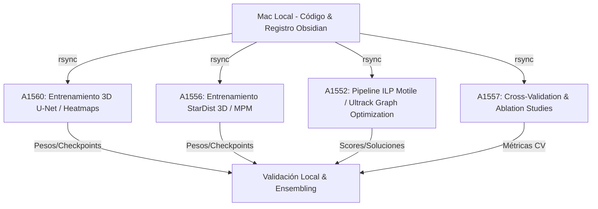

# 🖥️ Infraestructura de Cómputo Remoto Disponible (Cluster GPU)
**Máquinas autorizadas para la experimentación y entrenamiento del desafío Biohub**

> [!IMPORTANT]
> Para el desarrollo de experimentos, entrenamientos de modelos 3D y optimización de pipelines de tracking en esta competencia, las **únicas 4 computadoras disponibles y autorizadas** son:
> 1. **`A1560-UBU`**
> 2. **`A1552-UBU`**
> 3. **`A1556-UBU`**
> 4. **`A1557-UBU`**

Todas las máquinas cuentan con GPU **NVIDIA GeForce RTX 4090 (24 GB VRAM)** y están conectadas a la red mesh de **Tailscale** (`cuentaauxiliar2a2parte@gmail.com`).

---

## 📋 Tabla Resumen de Máquinas Disponibles

| Nombre | Dirección IP Tailscale | Puerto SSH | GPU / VRAM | Usuario | Conda Env Base/Trabajo | Estado / Notas |
|:---:|:---:|:---:|:---:|:---:|:---:|:---|
| **`A1560-UBU`** | `100.84.253.117` | `2222` | RTX 4090 (24 GB) | `alumno1` | `train-60` / `base` | **OFFLINE**; no lanzar hasta reconectar |
| **`A1552-UBU`** | `100.112.138.117` | `2222` | RTX 4090 (24 GB) | `alumno1` | `train-52` | Online; dependencias Biohub y CUDA verificadas |
| **`A1556-UBU`** | `100.107.113.22` | `2222` | RTX 4090 (24 GB) | `alumno1` | `train-56` / `base` | Lista para entrenamiento pesado |
| **`A1557-UBU`** | `100.87.128.33` | `2222` | RTX 4090 (24 GB) | `alumno1` | `train-57` | Online; dependencias Biohub y CUDA verificadas |

> [!NOTE]
> **Total de Capacidad de Cómputo:** **4x NVIDIA RTX 4090 (96 GB VRAM combinados)** en paralelo.

---

## 🔑 Credenciales y Parámetros Comunes de Conexión

- **Autenticación:** Llave SSH Ed25519 de la Mac (`~/.ssh/id_ed25519`) $\to$ `~/.ssh/authorized_keys` en cada remota.
- **Sin privilegios sudo:** Ninguna máquina posee acceso de superusuario (`sudo`). Todos los paquetes, dependencias (Conda/Pip/Tailscale/SSHD) operan en espacio de usuario (`userspace`).
- **Puerto SSH de Usuario:** Siempre usar `-p 2222` (el puerto 22 del sistema no admite llaves por `root_squash` en NFS).
- **Transferencia de Archivos:** Usar exclusivamente **`rsync`**, nunca `scp` (el daemon sshd de usuario no incluye subsistema sftp).

---

## ⚡ Comandos Rápidos de Acceso y Verificación

### 1. Test de Estado de GPU por Máquina

```bash
# A1560-UBU
ssh -p 2222 -o BatchMode=yes -o ConnectTimeout=8 alumno1@100.84.253.117 "hostname && nvidia-smi --query-gpu=name,memory.total,memory.free,utilization.gpu --format=csv"

# A1552-UBU
ssh -p 2222 -o BatchMode=yes -o ConnectTimeout=8 alumno1@100.112.138.117 "hostname && nvidia-smi --query-gpu=name,memory.total,memory.free,utilization.gpu --format=csv"

# A1556-UBU
ssh -p 2222 -o BatchMode=yes -o ConnectTimeout=8 alumno1@100.107.113.22 "hostname && nvidia-smi --query-gpu=name,memory.total,memory.free,utilization.gpu --format=csv"

# A1557-UBU
ssh -p 2222 -o BatchMode=yes -o ConnectTimeout=8 alumno1@100.87.128.33 "hostname && nvidia-smi --query-gpu=name,memory.total,memory.free,utilization.gpu --format=csv"
```

---

## 📦 Sincronización de Código y Datasets (`rsync`)

### Subir código/experimento desde la Mac a una máquina remota:
```bash
# Ejemplo hacia A1560
rsync -av --exclude '.git' --exclude '__pycache__' -e "ssh -p 2222" ./ alumno1@100.84.253.117:Documents/Biohub/

# Ejemplo hacia A1552
rsync -av --exclude '.git' --exclude '__pycache__' -e "ssh -p 2222" ./ alumno1@100.112.138.117:Documents/Biohub/

# Ejemplo hacia A1556
rsync -av --exclude '.git' --exclude '__pycache__' -e "ssh -p 2222" ./ alumno1@100.107.113.22:Documents/Biohub/

# Ejemplo hacia A1557
rsync -av --exclude '.git' --exclude '__pycache__' -e "ssh -p 2222" ./ alumno1@100.87.128.33:Documents/Biohub/
```

### Descargar checkpoints / submission / resultados de una remota a la Mac:
```bash
rsync -av --partial -e "ssh -p 2222" alumno1@100.84.253.117:Documents/Biohub/results/ ./results_A1560/
```

---

## 🔄 Estrategia de Distribución de Carga para Biohub

Con 4 máquinas RTX 4090 independientes, podemos paralelizar el trabajo de forma masiva:



1. **`A1560-UBU` (Worker 1):** Entrenamiento de modelos de segmentación/detección 3D principales (3D U-Net, Focal Loss, Heatmap Regression).
2. **`A1556-UBU` (Worker 2):** Modelos de representación conjunta (MPM Motion Vectors, StarDist 3D polyhedra, Cellpose 3D).
3. **`A1552-UBU` (Worker 3):** Benchmarking y optimización de grafos espacio-temporales con `motile` / `ultrack` (resolución de ILP con SCIP/HiGHS).
4. **`A1557-UBU` (Worker 4):** Evaluación de validación cruzada completa (5-fold embryo-disjoint CV) y barrido de hiperparámetros (umbral de distancia, penalización de mitosis, filtrado de ramas).

---

## 🛡️ Protocolo de Ejecución Desacoplada (`nohup` + sentinel)

Para evitar que un corte de conexión en Tailscale mate el proceso de entrenamiento:

```bash
# Lanzar entrenamiento en background de forma segura
ssh -p 2222 alumno1@<IP_MAQUINA> "source ~/miniconda3/etc/profile.d/conda.sh && conda activate <ENV_NAME> && cd ~/Documents/Biohub && nohup bash -c 'python train.py > train.log 2>&1; echo \$? > train.done' >/dev/null 2>&1 &"

# Monitorear log en vivo
ssh -p 2222 alumno1@<IP_MAQUINA> "tail -f -n 50 ~/Documents/Biohub/train.log"

# Verificar si finalizó
ssh -p 2222 alumno1@<IP_MAQUINA> "test -f ~/Documents/Biohub/train.done && echo 'FINALIZADO con código:' \$(cat ~/Documents/Biohub/train.done) || echo 'AÚN CORRIENDO'"
```

---

## 📌 Referencia Técnica Completa
Para el detalle profundo de persistencia por boot (`systemd --user`), manejo de librerías DeepSpeed/CUDA y resolución de contingencias de red, consultar [SSH-Context.md](file:///Users/matias/Proyects/Biohub/SSH-Context.md).

---

## ☁️ Integración CamberCloud MCP (Límites de Cuenta GitHub Honor Roll)

Conexión MCP activa en `camber-mcp` (Usuario: `matiantezana` / `matycaba2016@gmail.com`).

**Límites estrictos de la cuenta (GitHub Honor Roll Plan):**
- 🟩 **40 CPU Hours**
- 🟩 **5 GPU Hours** (Single GPU NVIDIA L4 únicamente)
- 🟩 **50 GB Storage** (Stash File System)
- 🟩 **50 LLM Messages**
- 🟩 **Soporte:** Slack Community

> [!CAUTION]
> Cualquier trabajo o experimento que se envíe a través de `camber-mcp` debe respetar el límite máximo de **5 Horas de GPU** y **40 Horas de CPU**. Todo script enviado debe configurar un número máximo de épocas/tiempo para no sobrepasar la cuota del plan.

